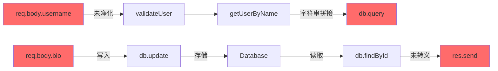

# 概述与边界

## 核心职责

- **聚焦**：追踪数据从Source（输入点）流向Sink（危险函数）的完整路径
- **输出**：数据流图 + 危险路径清单 + 未验证的污点传播路径
- **价值**：通过反向追溯快速定位漏洞，覆盖80%的注入类漏洞

## 分析范围

### ✅ 检测内容

| 检测维度 | 说明 | 示例 |
|---------|------|------|
| **正向追踪** | 从输入点追踪数据去向 | `req.body.username` → 最终流向哪里？ |
| **反向追溯** | 从危险函数倒推数据来源 | `exec()` 的参数从哪里来？ |
| **二阶攻击** | 存储→读取→使用的延迟攻击 | DB写入 → DB读取 → SQL查询 |
| **污点传播** | 跨函数、跨文件的数据传递 | `validate(input)` → `process()` → `save()` |
| **净化检测** | 识别数据流路径中的清理/转义 | 是否经过 `escape()`、`sanitize()` |

### ❌ 明确不做

- 不执行实际攻击或利用
- 不分析运行时行为（纯静态分析）
- 不深入分析具体漏洞类型（由对应analyzer完成）
- 不做配置参数验证（由config-env-analyzer完成）

---

## 核心概念

### Source（数据源）定义

```yaml
sources:
  # 1. 外部用户输入（高危）
  http_input:
    - "req.body.*"
    - "req.query.*"
    - "req.params.*"
    - "req.headers.*"
    - "$_GET", "$_POST", "$_REQUEST"
    - "request.getParameter()"
    - "c.Query()", "c.PostForm()"

  file_upload:
    - "req.files.*"
    - "multipart.File"
    - "$_FILES"

  # 2. 配置参数（中危）
  config_input:
    - "config.*"
    - "process.env.*"
    - "os.getenv()"
    - "System.getenv()"
    - "settings.*"

  # 3. 数据库/缓存读取（二阶攻击）
  storage_input:
    - "db.find()", "db.findOne()"
    - "redis.get()", "memcached.get()"
    - "SELECT * FROM ..."
    - "User.findById()"

  # 4. 文件读取
  file_input:
    - "fs.readFileSync()"
    - "file_get_contents()"
    - "Files.readAllBytes()"

  # 5. 网络请求响应
  network_input:
    - "http.get()", "fetch()"
    - "requests.get()"
    - "curl_exec()"
```

### Sink（危险函数）定义

```yaml
sinks:
  # 1. 命令执行
  command_execution:
    - "exec()", "spawn()", "execSync()"
    - "system()", "shell_exec()", "passthru()"
    - "Runtime.exec()", "ProcessBuilder()"
    - "os.system()", "subprocess.Popen()"

  # 2. SQL查询
  sql_query:
    - "db.query()", "db.raw()", "db.execute()"
    - "mysql_query()", "mysqli_query()"
    - "Statement.execute()", "createQuery()"
    - "cursor.execute()"

  # 3. 代码执行
  code_execution:
    - "eval()", "Function()"
    - "eval()", "exec()"
    - "vm.runInContext()"

  # 4. 文件操作
  file_operations:
    - "fs.readFile()", "fs.writeFile()"
    - "fopen()", "file_put_contents()"
    - "FileInputStream()", "FileOutputStream()"

  # 5. HTML输出（XSS）
  html_output:
    - "res.send()", "res.write()"
    - "echo", "print"
    - "innerHTML", "outerHTML", "document.write()"

  # 6. 网络请求（SSRF）
  http_request:
    - "http.request()", "fetch()"
    - "curl_exec()", "file_get_contents(http://)"
    - "HttpURLConnection.connect()"

  # 7. 反序列化
  deserialization:
    - "JSON.parse()", "eval()"
    - "pickle.loads()", "yaml.load()"
    - "ObjectInputStream.readObject()"

  # 8. 路径操作
  path_operations:
    - "path.join()", "path.resolve()"
    - "realpath()", "file_exists()"
    - "Paths.get()"
```

---

## 分析策略

### 策略1：反向追溯（推荐）

从危险Sink倒推数据来源，效率最高。

```python
# 伪代码示例
def reverse_trace():
    # 1. 找到所有危险Sink
    sinks = find_all_sinks([
        "exec", "spawn", "eval",
        "db.query", "db.raw",
        "fs.readFile"
    ])

    # 2. 对每个Sink反向追溯参数来源
    for sink in sinks:
        params = extract_sink_parameters(sink)

        for param in params:
            sources = trace_backward(param)

            # 3. 检查来源是否为用户可控
            for source in sources:
                if is_user_controllable(source):
                    if not has_sanitization(param, source):
                        report_vulnerability(source, sink, path)
```

**示例追溯链**：

```javascript
// Sink: exec() - 从这里开始反向追溯
exec(`git clone -b ${branch} ${url}`)  // ← 第0层：Sink

// ← 第1层：branch 从哪里来？
const branch = config.branch

// ← 第2层：config 从哪里来？
const config = parseWorkflowConfig(workflowId)

// ← 第3层：workflowId 从哪里来？
const workflowId = req.body.id

// ← 第4层：req.body 是用户输入！Source 找到了
// 完整路径：req.body.id → parseWorkflowConfig → config.branch → exec()
```

---

### 策略2：正向追踪

从已知的用户输入点正向追踪数据去向。

```python
def forward_trace():
    # 1. 找到所有用户输入点
    sources = find_all_sources([
        "req.body", "req.query", "req.params",
        "$_GET", "$_POST",
        "request.getParameter()"
    ])

    # 2. 对每个输入点正向追踪
    for source in sources:
        sinks = trace_forward(source)

        # 3. 检查是否流向危险函数
        for sink in sinks:
            if is_dangerous_sink(sink):
                if not has_sanitization(source, sink):
                    report_vulnerability(source, sink, path)
```

**示例追踪链**：

```python
# Source: 用户输入 - 从这里开始正向追踪
username = request.GET['username']  # ← 第0层：Source

# → 第1层：传递给验证函数
user = validate_user(username)

# → 第2层：传递给查询函数
def validate_user(name):
    return get_user_by_name(name)

# → 第3层：拼接到SQL查询
def get_user_by_name(name):
    query = f"SELECT * FROM users WHERE name='{name}'"  # ← Sink找到了
    db.execute(query)

# 完整路径：request.GET → validate_user → get_user_by_name → db.execute
```

---

### 策略3：二阶攻击检测

追踪"存储→读取→使用"的延迟攻击路径。

```python
def detect_second_order():
    # 1. 找到所有写入操作
    writes = find_all_writes([
        "db.insert()", "db.update()",
        "redis.set()", "fs.writeFile()"
    ])

    # 2. 找到所有读取操作
    reads = find_all_reads([
        "db.find()", "db.query()",
        "redis.get()", "fs.readFile()"
    ])

    # 3. 关联写入和读取
    for write in writes:
        # 追踪写入的数据来源
        write_sources = trace_backward(write.data)

        if is_user_controllable(write_sources):
            # 查找同一存储的读取操作
            related_reads = find_reads_from_same_storage(write.storage)

            for read in related_reads:
                # 追踪读取后的数据去向
                read_sinks = trace_forward(read.data)

                if has_dangerous_sink(read_sinks):
                    report_second_order_attack(write, read, sink)
```

**二阶攻击示例**：

```javascript
// 第一阶段：污染数据写入数据库
app.post('/profile', (req, res) => {
    const bio = req.body.bio;  // 用户输入：<script>alert(1)</script>
    db.update('users', { bio: bio });  // 写入数据库（未净化）
});

// 第二阶段：读取并输出到页面
app.get('/admin/users', (req, res) => {
    const users = db.findAll('users');  // 读取数据库
    res.send(`<div>${users[0].bio}</div>`);  // XSS触发！
});

// 数据流：
// req.body.bio → db.update() → 数据库存储
//   ↓ (延迟)
// db.findAll() → res.send() → XSS
```

---

## 净化检测

识别数据流路径中的清理/转义/验证函数。

### 常见净化函数

```yaml
sanitization_functions:
  # SQL注入防护
  sql:
    - "escape()", "escapeId()"
    - "parameterized_query()", "prepare()"
    - "mysqli_real_escape_string()"

  # XSS防护
  xss:
    - "htmlspecialchars()", "htmlentities()"
    - "escapeHtml()", "sanitizeHtml()"
    - "DOMPurify.sanitize()"

  # 命令注入防护
  command:
    - "shellEscape()", "shlex.quote()"
    - "execFile()" # 参数化执行，不使用shell

  # 路径遍历防护
  path:
    - "path.normalize()", "path.basename()"
    - "realpath()", "sanitizePath()"

  # 通用验证
  validation:
    - "validator.isAlphanumeric()"
    - "zod.string().parse()"
    - "Joi.validate()"
```

### 净化有效性判断

```python
def is_effective_sanitization(sanitizer, sink_type):
    """判断净化函数是否有效"""

    effectiveness_map = {
        "sql_query": ["escape", "prepare", "parameterize"],
        "xss": ["htmlspecialchars", "escapeHtml", "DOMPurify"],
        "command_execution": ["shellEscape", "execFile"],
        "path_traversal": ["normalize", "basename", "realpath"]
    }

    effective_functions = effectiveness_map.get(sink_type, [])

    return any(func in sanitizer for func in effective_functions)
```

**无效净化示例**：

```javascript
// ❌ 无效：使用了净化函数，但针对错误的漏洞类型
const username = htmlspecialchars(req.body.username);  // XSS防护
db.query(`SELECT * FROM users WHERE name='${username}'`);  // SQL注入！

// ✅ 有效：正确的净化方式
db.query('SELECT * FROM users WHERE name=?', [username]);
```

---

## 输出要求

### 1. 数据流图文件

**输出路径**：`.workspace/tasks/{TASK_ID}/dataflow-analysis.json`

```json
{
  "dimension": "dataflow",
  "scan_time": "2025-12-16T10:30:00Z",
  "statistics": {
    "total_sources": 45,
    "total_sinks": 23,
    "total_paths": 156,
    "dangerous_paths": 12,
    "second_order_attacks": 3,
    "sanitized_paths": 8
  },
  "dataflows": [
    {
      "id": "df-001",
      "source": {
        "type": "http_input",
        "category": "user_controllable",
        "location": "src/api/user.js:45",
        "variable": "req.body.username",
        "code_snippet": "const username = req.body.username;"
      },
      "sink": {
        "type": "sql_query",
        "category": "dangerous",
        "location": "src/db/user.js:120",
        "function": "db.query",
        "code_snippet": "db.query(`SELECT * FROM users WHERE name='${username}'`)"
      },
      "path": [
        {
          "step": 1,
          "location": "src/api/user.js:45",
          "action": "req.body.username → username"
        },
        {
          "step": 2,
          "location": "src/api/user.js:48",
          "action": "username → validateUser(username)"
        },
        {
          "step": 3,
          "location": "src/services/auth.js:67",
          "action": "validateUser → getUserByName(name)"
        },
        {
          "step": 4,
          "location": "src/db/user.js:120",
          "action": "getUserByName → db.query(sql)"
        }
      ],
      "sanitization": [],
      "risk": "CRITICAL",
      "vulnerability": "SQL Injection",
      "confidence": "HIGH",
      "description": "用户输入req.body.username未经净化直接拼接到SQL查询",
      "poc": "username: admin' OR '1'='1"
    },
    {
      "id": "df-002",
      "source": {
        "type": "storage_input",
        "category": "second_order",
        "location": "src/db/user.js:89",
        "variable": "user.bio",
        "code_snippet": "const bio = user.bio;"
      },
      "sink": {
        "type": "html_output",
        "category": "dangerous",
        "location": "src/views/profile.js:34",
        "function": "res.send",
        "code_snippet": "res.send(`<div>${bio}</div>`)"
      },
      "path": [
        {
          "step": 1,
          "location": "src/api/profile.js:12 (写入阶段)",
          "action": "req.body.bio → db.update({bio: bio})"
        },
        {
          "step": 2,
          "location": "src/db/user.js:89 (读取阶段)",
          "action": "db.findById() → user.bio"
        },
        {
          "step": 3,
          "location": "src/views/profile.js:34",
          "action": "user.bio → res.send()"
        }
      ],
      "sanitization": [],
      "risk": "HIGH",
      "vulnerability": "Stored XSS (Second Order)",
      "confidence": "MEDIUM",
      "description": "用户输入bio写入数据库后，读取时未转义直接输出到HTML",
      "poc": "bio: <script>alert(document.cookie)</script>",
      "attack_type": "second_order",
      "storage": "database.users.bio"
    }
  ]
}
```

### 2. 可视化数据流图（可选）

**输出路径**：`.workspace/tasks/{TASK_ID}/dataflow-graph.mermaid`



### 3. 下游任务推荐

```json
{
  "tasks": [
    {
      "artifact": ".workspace/tasks/{TASK_ID}/dataflow-analysis.json",
      "skill": "sql-injection-analyzer",
      "context": {
        "focus_paths": ["df-001"],
        "reason": "发现用户输入→SQL查询的未净化路径"
      }
    },
    {
      "artifact": ".workspace/tasks/{TASK_ID}/dataflow-analysis.json",
      "skill": "xss-analyzer",
      "context": {
        "focus_paths": ["df-002"],
        "reason": "发现二阶XSS：存储→读取→输出"
      }
    }
  ]
}
```

---

## 实现指南

### 使用AST解析器

```python
# 使用tree-sitter进行AST解析
from tree_sitter import Language, Parser

def analyze_dataflow(file_path, language):
    """分析单个文件的数据流"""

    # 1. 解析代码生成AST
    parser = Parser()
    parser.set_language(Language(f'tree-sitter-{language}'))

    with open(file_path, 'rb') as f:
        tree = parser.parse(f.read())

    # 2. 查找所有Source
    sources = find_sources(tree)

    # 3. 查找所有Sink
    sinks = find_sinks(tree)

    # 4. 构建数据流图
    dataflow_graph = build_dataflow_graph(tree)

    # 5. 对每个Sink进行反向追溯
    for sink in sinks:
        paths = trace_backward(sink, dataflow_graph)

        for path in paths:
            if path.source in sources and not path.has_sanitization():
                yield DataflowVulnerability(path)
```

### 跨文件追踪

```python
def trace_across_files(symbol, project_root):
    """跨文件追踪符号传播"""

    # 1. 查找符号定义
    definition = find_symbol_definition(symbol)

    # 2. 查找符号引用
    references = find_symbol_references(symbol, project_root)

    # 3. 构建跨文件调用图
    call_graph = build_call_graph(references)

    # 4. 递归追踪
    for ref in references:
        if ref.type == "function_call":
            # 进入被调用函数继续追踪
            trace_in_function(ref.target_function)
```

---

## 优先级建议

### P0 - 必须检测

1. ✅ HTTP输入 → SQL查询
2. ✅ HTTP输入 → 命令执行
3. ✅ HTTP输入 → 文件操作
4. ✅ 配置参数 → 命令执行

### P1 - 高优先级

5. 数据库读取 → SQL查询（二阶注入）
6. 数据库读取 → HTML输出（存储型XSS）
7. HTTP输入 → SSRF

### P2 - 中优先级

8. 缓存读取 → 代码执行
9. 文件读取 → 反序列化
10. 网络响应 → 命令执行

---

## 与其他维度的协作

### 前置依赖

- **project-profiler**: 提供项目语言/框架信息
- **route-scanner**: 提供API端点清单

### 后置触发

- **sql-injection-analyzer**: 深入分析SQL注入路径
- **xss-analyzer**: 深入分析XSS路径
- **command-injection-analyzer**: 深入分析命令注入路径
- **trust-boundary-analyzer**: 分析跨边界的数据流

### 数据共享

```json
{
  "shared_data": {
    "dataflow_graph": ".workspace/tasks/{TASK_ID}/dataflow-analysis.json",
    "usage": "其他analyzer可以引用此文件获取数据流信息"
  }
}
```

---

## 重要约束

1. ⚠️ **仅静态分析**：不执行代码，不做动态污点追踪
2. ⚠️ **路径深度限制**：跨函数追踪深度建议不超过10层，避免性能问题
3. ⚠️ **误报处理**：标注confidence字段，HIGH/MEDIUM/LOW
4. ⚠️ **净化识别**：需要准确识别净化函数，避免误报
5. ✅ **输出标准化**：必须使用统一的JSON格式

---

## 参考资料

### 学术论文
- [Andromeda: Accurate and Scalable Security Analysis of Web Applications](https://www.usenix.org/conference/usenixsecurity12/technical-sessions/presentation/tripp)
- [FlowDroid: Precise Context, Flow, Field, Object-sensitive and Lifecycle-aware Taint Analysis for Android Apps](https://dl.acm.org/doi/10.1145/2594291.2594299)

### 工具参考
- [CodeQL](https://codeql.github.com/)
- [Semgrep](https://semgrep.dev/)
- [Joern](https://joern.io/)

### 框架API
- [tree-sitter](https://tree-sitter.github.io/tree-sitter/)
- [Python ast module](https://docs.python.org/3/library/ast.html)
