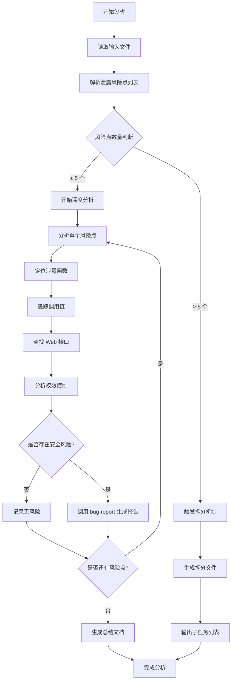

# 概述与边界

## 核心职责

- **聚焦**：深度分析敏感信息泄露函数，判断是否存在通过 Web 接口的越权泄露风险
- **输出**：漏洞报告（如发现安全问题）+ 分析总结文档

## 输入约束

### 泄露风险点来源限制

**严格约束**：本技能仅分析输入文件中明确列出的泄露风险点，禁止自行扫描或扩展分析范围。
**允许的输入来源**：
- `sensitive-info-scanner` 生成的泄露函数分析文件 `.workspace/tasks/{TASK_ID}/sensitive-leak-{priority}-group{N}.md`

#### 禁止行为

❌ **禁止自行扫描项目发现新的泄露风险点**
❌ **禁止扩展到输入文件未列出的泄露风险点**
❌ **禁止分析输入范围外的代码**
❌ **禁止推测或补全缺失的泄露风险点**

# 分析目标

本技能专注于判断敏感信息泄露是否存在实际安全风险，重点识别以下场景：

## 1. 通过 Web 接口返回敏感信息

分析泄露函数是否会通过以下方式向外暴露敏感信息：
- **HTTP 响应**：通过 API 端点直接返回敏感数据
- **WebSocket 推送**：通过实时通信推送敏感信息
- **SSE（Server-Sent Events）**：通过服务器推送事件返回敏感数据

## 2. 越权访问敏感信息

判断敏感信息是否超过用户角色所具备的权限：
- **无认证访问**：未授权用户可访问敏感信息
- **普通用户越权**：普通用户可访问管理员级别的敏感信息
- **横向越权**：用户可访问其他用户的敏感信息
- **未脱敏返回**：敏感信息未经脱敏直接返回（如完整手机号、身份证号）

# 执行流程



## 步骤 1: 输入验证与拆分判断

### 1.1 读取输入文件

- 读取 `sensitive-info-scanner` 生成的泄露函数分析文件
- 解析文件中列出的所有泄露风险点（文件路径 + 行号）

### 1.2 风险点数量判断与拆分

**触发条件**：当待分析的泄露风险点数量超过 5 个（即 ≥ 6 个）时，触发拆分机制。

**约束**：拆分时仅对输入文件中列出的泄露风险点进行分组，不得添加新的风险点。

**处理流程**：

1. **统计风险点数量**：统计输入文件中的泄露风险点总数
2. **判断是否拆分**：
   - 如果风险点数量 ≤ 5，直接进行深度分析
   - 如果风险点数量 ≥ 6，触发拆分机制
3. **拆分处理**（如触发）：
   - 立即停止分析，不执行任何风险点的详细分析
   - 将泄露风险点按每 5 个一组进行拆分
   - 为每一组创建一个新的 `sensitive-deep-analyzer` 任务

**拆分输出格式**：

1. **生成分组风险点文件**：为每组生成独立的风险点清单文件 `.workspace/tasks/{TASK_ID}/sensitive-leak-analysis-group-{N}.md`
2. **输出任务列表**：每组对应一个子任务

```json
{
  "tasks": [
    {
      "artifact": ".workspace/tasks/{TASK_ID}/sensitive-leak-analysis-group-1.md",
      "skill": "sensitive-deep-analyzer",
      "dependencies": [
        ".workspace/tasks/{WEB_AUTH_TASK_ID}/web-auth-analyzer.md",
        ".workspace/tasks/{UNAUTH_ROUTE_SCANNER_TASK_ID}/unauth-route-scanner.md",
        ".workspace/tasks/{NORMAL_ROUTE_SCANNER_TASK_ID}/normal-route-scanner.md"
      ]
    },
    {
      "artifact": ".workspace/tasks/{TASK_ID}/sensitive-leak-analysis-group-2.md",
      "skill": "sensitive-deep-analyzer",
      "dependencies": [
        ".workspace/tasks/{WEB_AUTH_TASK_ID}/web-auth-analyzer.md",
        ".workspace/tasks/{UNAUTH_ROUTE_SCANNER_TASK_ID}/unauth-route-scanner.md",
        ".workspace/tasks/{NORMAL_ROUTE_SCANNER_TASK_ID}/normal-route-scanner.md"
      ]
    },
    ...
  ]
}
```

**分组风险点文件格式**：

每个 `sensitive-leak-analysis-group-{N}.md` 文件内容：

```markdown
# 敏感信息泄露深度分析 - 分组 {N}

## 基本信息
- **分组编号**：{N}
- **风险点数量**：{count}
- **数据来源**：[原始输入文件路径]

## 泄露风险点列表

### [FINDING-001] {泄露内容描述}
- 文件路径：{file_path}:{line_number}
- 文件路径：{file_path}:{line_number}
- ...

### [FINDING-002] {泄露内容描述}
- 文件路径：{file_path}:{line_number}
- ...

## 约束说明

本分组中的所有风险点均来自原始输入文件，仅分析本分组列表中的风险点。
```

## 步骤 2: 深度分析流程

对输入文件中列出的每个泄露风险点（分组后 ≤ 5 个）进行以下分析：

### 2.1 定位泄露函数代码

**目标**：读取并理解泄露风险点的完整代码逻辑

**操作步骤**：
1. 读取泄露风险点所在的源文件，获取完整代码上下文
2. 定位到具体的代码行号
3. 识别泄露函数的范围（起始行到结束行）
4. 理解函数的完整逻辑：
   - 输入参数
   - 敏感信息来源（如 `process.env`、`config`、数据库查询结果）
   - 返回值或输出方式

**关键点**：
- 识别敏感信息的**数据源**（Source）
- 识别敏感信息的**输出点**（Sink）

### 2.2 追踪函数调用链

**目标**：找出哪些代码会调用这个泄露函数

**操作步骤**：
1. 使用 `Grep` 工具搜索泄露函数的调用点：
   - 搜索函数名（如 `getEnvVariables`）
   - 搜索模式：`{function_name}\s*\(`，启用 `-B 3 -C 3` 显示上下文
2. 对每个调用点进行分析：
   - 调用点所在的文件和行号
   - 调用点的上下文（是否在路由处理函数中）
   - 调用结果如何被使用（直接返回、赋值、传递）

**关键点**：
- 构建从泄露函数到 Web 接口的**完整调用链**
- 记录调用链中的每一层：`Web路由 -> Controller -> Service -> 泄露函数`

### 2.3 查找关联的 Web 接口

**目标**：判断泄露函数是否会通过 Web 接口向外暴露

**操作步骤**：
1. **直接关联**：检查泄露函数是否直接作为路由处理函数
   - 使用 `Grep` 工具搜索路由注册代码（如 `app.get`、`router.post`、`@RequestMapping`）
   - 检查路由处理函数是否直接调用泄露函数

2. **间接关联**：通过调用链追溯到 Web 接口
   - 从调用链中识别路由处理函数（Controller、Handler）
   - 定位路由处理函数对应的路由路径和 HTTP 方法
   - 确认泄露函数的返回值是否会被包含在 HTTP 响应中

3. **关联类型判断**：
   - **直接返回**：泄露函数的返回值直接作为 HTTP 响应返回
   - **部分返回**：泄露函数的返回值作为响应对象的一部分返回
   - **条件返回**：泄露函数的返回值在特定条件下返回（如调试模式、特定参数）
   - **无关联**：泄露函数仅在内部使用，不会通过 Web 接口返回

**关键点**：
- 记录关联的 Web 接口：`{HTTP方法} {路由路径}`
- 明确泄露信息在响应中的位置和格式

### 2.4 分析权限控制机制

**目标**：判断访问关联 Web 接口需要什么权限，是否存在越权风险

**前置条件**：仅当存在关联 Web 接口时才进行权限分析

**操作步骤**：

1. **读取认证分析结果**（如可用）：
   - 从依赖项中读取 `web-auth-analyzer` 的分析结果
   - 了解项目的认证机制（JWT、Session、API Key 等）
   - 了解项目的角色体系（admin、user、guest 等）

2. **检查接口级别的权限控制**：
   - **中间件检查**：查找路由上应用的认证/授权中间件
     - 使用 `Grep` 搜索中间件定义（如 `authenticate`、`authorize`、`@RequireAuth`）
     - 确认中间件的权限要求（是否需要登录、是否需要特定角色）
   - **装饰器/注解检查**：查找路由上的权限注解
     - 如 `@admin_required`、`@login_required`、`@Roles(['admin'])`
   - **内联检查**：查看路由处理函数内部的权限检查代码
     - 如 `if (!user.isAdmin) throw new Error(...)`

3. **判断访问权限级别**：
   - **公开接口**：无需认证即可访问
   - **需要登录**：需要有效的登录凭证（任何角色）
   - **需要特定角色**：需要特定角色（如 admin、superuser）
   - **需要特定权限**：需要特定权限（如 `config:read`、`users:manage`）

4. **分析数据范围控制**：
   - **全局数据**：是否返回所有用户/所有租户的数据
   - **当前用户数据**：是否仅返回当前用户的数据
   - **过滤逻辑**：是否有数据过滤、脱敏逻辑
     - 检查是否有黑名单/白名单过滤敏感字段
     - 检查是否有脱敏处理（如手机号 `138****1234`）

**关键点**：
- 记录接口的**权限要求**（无需认证、需要登录、需要特定角色）
- 记录接口返回数据的**范围控制**（全局、当前用户、是否脱敏）

### 2.5 风险判定与分类

**目标**：根据权限控制分析结果，判断是否存在安全风险及风险等级

#### 风险判定决策树

```
是否通过 Web 接口返回敏感信息？
├─ 否 → 无风险（仅内部使用）
└─ 是 → 检查权限控制
    ├─ 无需认证可访问
    │   ├─ 返回系统级敏感信息（环境变量/数据库密码/私钥） → P0 Critical
    │   └─ 返回业务敏感信息（用户数据/配置信息） → P1 High
    ├─ 需要登录可访问
    │   ├─ 返回其他用户的敏感信息（横向越权） → P0 Critical
    │   ├─ 返回超出权限的敏感信息（纵向越权） → P1 High
    │   └─ 返回当前用户自己的敏感信息但未脱敏 → P2 Medium
    └─ 需要特定角色可访问
        ├─ 权限控制存在绕过漏洞 → P0 Critical
        └─ 权限控制正常但未脱敏 → P2 Medium
```

#### 风险等级定义

| 等级 | 定义 | 示例 |
|------|------|------|
| **P0 Critical** | 未授权用户可访问系统级敏感信息，或存在严重越权 | 公开接口返回环境变量、数据库密码、所有用户数据；横向越权访问其他用户的敏感信息；认证绕过导致管理员接口被访问 |
| **P1 High** | 未授权用户可访问业务敏感信息，或普通用户可访问超出权限的敏感信息 | 公开接口返回配置信息、API Key；普通用户可访问管理员级别的敏感数据（纵向越权） |
| **P2 Medium** | 用户可访问自己的敏感信息但未脱敏，或存在信息泄露风险但影响有限 | 用户可查询自己的完整手机号、身份证号；调试接口泄露配置信息但需要特定参数 |
| **无风险** | 敏感信息仅在内部使用，不会通过 Web 接口返回；或有适当的权限控制和脱敏处理 | 敏感信息仅在服务器日志中使用；敏感信息返回前经过脱敏处理；严格的权限控制确保仅管理员可访问 |

#### 判定示例

**示例 1：环境变量导出 - P0 Critical**
- **泄露函数**：`function getAllEnv() { return process.env; }`
- **调用链**：`GET /api/debug/env -> debugController.getEnv() -> getAllEnv()`
- **权限控制**：无认证要求
- **风险判定**：P0 Critical - 未授权用户可访问所有环境变量（可能包含数据库密码、API Key）

**示例 2：用户数据泄露 - P0 Critical**
- **泄露函数**：`function getUserById(id) { return db.users.findById(id); }`
- **调用链**：`GET /api/users/:id -> userController.getUser() -> getUserById()`
- **权限控制**：需要登录，但未校验当前用户是否有权访问目标用户数据
- **风险判定**：P0 Critical - 横向越权，用户可访问其他用户的敏感信息

**示例 3：配置信息泄露 - P1 High**
- **泄露函数**：`function getConfig() { return app.config; }`
- **调用链**：`GET /api/config -> configController.getConfig() -> getConfig()`
- **权限控制**：无认证要求
- **风险判定**：P1 High - 未授权用户可访问配置信息（可能包含 API Key、第三方服务地址）

**示例 4：未脱敏返回 - P2 Medium**
- **泄露函数**：`function getUserProfile(userId) { return { phone: user.phone, email: user.email }; }`
- **调用链**：`GET /api/profile -> profileController.getProfile() -> getUserProfile()`
- **权限控制**：需要登录，且仅返回当前用户自己的数据
- **风险判定**：P2 Medium - 用户可查询自己的完整手机号和邮箱，未脱敏

**示例 5：仅内部使用 - 无风险**
- **泄露函数**：`function logConfig() { logger.info(config); }`
- **调用链**：仅在服务器启动时调用，不通过 Web 接口暴露
- **权限控制**：N/A
- **风险判定**：无风险 - 敏感信息仅在服务器日志中使用，不对外暴露

## 步骤 3: 生成漏洞报告或总结

### 3.1 存在安全风险 → 调用 bug-report 生成漏洞报告

**触发条件**：当风险判定结果为 P0、P1、P2 时，调用 `bug-report` 技能生成漏洞报告

**调用方式**：
- 激活 `bug-report` 技能并按照其模板格式生成漏洞报告文件

### 3.2 无安全风险 → 生成总结文档

**触发条件**：当所有分析的泄露风险点均无安全风险时，生成总结文档

**文件路径**：`.workspace/tasks/{TASK_ID}/sensitive-deep-analysis-summary.md`

**文件内容格式**：

```markdown
# 敏感信息泄露深度分析总结

## 分析概览
- **任务 ID**：{TASK_ID}
- **输入文件**：{input_file_path}
- **分析风险点数量**：{count}
- **发现漏洞数量**：{vulnerability_count}
- **分析时间**：{timestamp}

## 风险点分析结果

### [FINDING-001] {泄露内容描述}
- **文件路径**：{file_path}:{line_number}
- **泄露函数**：`{function_name}`
- **调用链**：{调用链路径}
- **关联 Web 接口**：{HTTP方法} {路由路径}（如有）
- **权限控制**：{权限要求描述}
- **风险判定**：{P0/P1/P2/无风险}
- **判定理由**：{详细说明为何判定为该风险等级}

### [FINDING-002] {泄露内容描述}
- ...

## 漏洞报告清单

### P0 Critical 级别
{如有，列出生成的漏洞报告文件路径}

### P1 High 级别
{如有，列出生成的漏洞报告文件路径}

### P2 Medium 级别
{如有，列出生成的漏洞报告文件路径}

## 安全建议

{如有无风险的风险点，可在此说明为何判定为无风险，以及哪些安全措施起了作用}

## 总结

{总体评估项目在敏感信息泄露方面的安全状况}
```

### 3.3 输出分析结果

**总结输出格式（JSON格式）**：

```json
{"tasks": []} // 空数组，因为本技能不生成下游任务
```

## 常见误判场景

**避免误报**：以下情况不应判定为漏洞

1. **敏感信息仅在内部使用**：
   - 仅在服务器日志中记录
   - 仅在内部函数间传递，不对外暴露

2. **严格的权限控制**：
   - 接口需要管理员权限，且权限检查严格
   - 敏感信息仅管理员可访问，且无绕过漏洞

3. **完善的数据过滤和脱敏**：
   - 敏感字段被黑名单过滤
   - 敏感信息经过脱敏处理（如手机号 `138****1234`）

4. **调试接口在生产环境已禁用**：
   - 调试接口仅在开发环境启用（通过环境变量控制）
   - 生产环境无法访问调试接口

**避免漏报**：以下情况应判定为漏洞

1. **条件性泄露**：
   - 需要特定参数（如 `?debug=true`）才会泄露敏感信息
   - 虽然有条件限制，但仍然存在泄露风险

2. **不完整的过滤**：
   - 过滤逻辑存在遗漏（如只过滤了部分敏感字段）
   - 过滤逻辑可被绕过（如通过大小写绕过）

3. **弱的权限控制**：
   - 权限检查存在逻辑漏洞（如使用 `||` 而非 `&&`）
   - 权限检查依赖客户端参数（如 `req.body.isAdmin`）

4. **隐式越权**：
   - 接口返回的数据包含其他用户的敏感信息（如批量查询接口）
   - 未检查当前用户是否有权访问目标资源

---

**重要提醒**：本技能的核心价值在于**准确判定风险等级**，避免误报和漏报。在分析过程中，务必：
- 深入理解代码逻辑，不要仅根据表面特征判断
- 完整追踪数据流，确保找到所有可能的泄露路径
- 仔细检查权限控制，不要遗漏任何权限检查逻辑
- 结合项目上下文（如认证机制、角色体系），做出准确的风险判断
