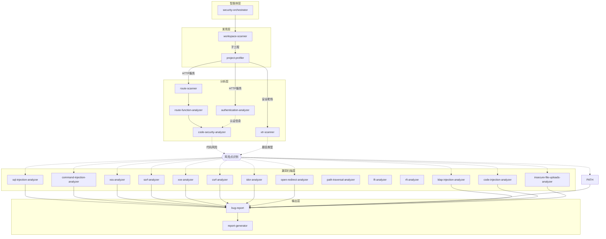

# Vul-AI-V2

基于 Claude Code 的自动化安全审计框架，通过 AI 智能体协作完成代码安全扫描。

## 核心能力概览

- 基于 tree-sitter 的快速扫描脚本（quick-scan）：
  - 路由扫描：`unauth-route-scanner`（未授权路由侧重）、`normal-route-scanner`（常规路由，软链复用同脚本）
  - 认证分析：`web-auth-analyzer`
  - 敏感信息扫描：`sensitive-info-scanner`
  - 工作区扫描：`workspace-scanner`
  - 项目画像：`project-profiler`
- 自动化覆盖 vs 人工分析：脚本负责结构化提取与模式识别；风险分级、业务语义与复杂豁免规则需结合产物手动分析。

## 依赖与环境

- Python ≥ 3.9
- `tree-sitter`、`tree-sitter-language-pack`、`jq`、`git`、`bash`
- 一键检查：`bash ./check-dependencies.sh`（缺失项会给出安装提示）

## 安装

```bash
# HTTPS 方式
git clone --recursive https://github.com/Clouditera/Vul-AI-V2.git

# SSH 方式
git clone --recursive git@github.com:Clouditera/Vul-AI-V2.git

# 已克隆后初始化子模块
git submodule update --init --recursive
```

## 快速开始

### 1. 链接配置到目标工程

```bash
cd /path/to/target-project
ln -s /path/to/Vul-AI-V2/.claude .claude
source .claude/skills/task-manage/scripts/setup.sh
```

### 2. 启动 Claude Code 并执行审计

```bash
claude
```

在 Claude Code 中输入：

```
@.claude/agents/security-orchestrator.md 审计当前项目
```

系统会自动调用 `security-orchestrator` 智能体进行全流程安全扫描。

### 3. 快速脚本示例（可单独运行）

```bash
# 路由扫描（未授权/常规，二者复用同脚本）
python3 .claude/skills/unauth-route-scanner/quick-scan.py . --output routes.md
# 认证分析
python3 .claude/skills/web-auth-analyzer/quick-scan.py . --output auth.md
# 敏感信息
python3 .claude/skills/sensitive-info-scanner/quick-scan.py . --output sensitive.md
# 输出 JSON
python3 .claude/skills/unauth-route-scanner/quick-scan.py . --json --output routes.json
```

> 说明：路由脚本不做认证判定；认证与风险分级需结合路由/上游产物手动分析。

### 4. 工作流速览（从发现到报告）

```
workspace-scanner → project-profiler → route-scanner（unauth/normal） → web-auth-analyzer → sensitive-info-scanner → report-generator
```

各 quick-scan 产物可直接作为后续分析输入：路由清单 → 认证分析 → 敏感信息 → 报告聚合。

## Security Orchestrator

核心编排智能体，负责统筹项目分类并协调子智能体执行安全扫描任务。

### 输入参数

| 参数 | 必填 | 说明 |
|------|------|------|
| 代码仓库 | 是 | 当前工作目录 |
| 扫描器白名单 | 否 | 指定启用的扫描器，如"只启用 sql-injection-analyzer" |
| 扫描器黑名单 | 否 | 指定禁用的扫描器，如"禁用 sensitive-info-scanner" |
| `SCAN_RANGE` | 否 | 子工程分析范围，如"分析前10个子工程"，默认分析前 5 个 |

### 执行流程

```
STEP 1: 工作区扫描 (workspace-scanner)
    ↓
    判断单一项目 / Monorepo
    ↓
STEP 2: 项目画像 (project-profiler)
    ↓
    识别技术栈，推荐扫描器
    ↓
STEP 3: 漏洞扫描 (各类 analyzer)
    ↓
    并行执行推荐的扫描任务
    ↓
STEP 4: 报告生成 (report-generator)
    ↓
    输出 audit-report.md / audit-report.json
```

### 支持的扫描器

| 扫描器 | 检测能力 |
|--------|----------|
| `sql-injection-analyzer` | SQL 注入 |
| `xss-analyzer` | 跨站脚本攻击 |
| `command-injection-analyzer` | 命令注入 |
| `code-injection-analyzer` | 代码注入 |
| `ssrf-analyzer` | 服务端请求伪造 |
| `xxe-analyzer` | XML 外部实体注入 |
| `csrf-analyzer` | 跨站请求伪造 |
| `idor-analyzer` | 不安全的直接对象引用 |
| `path-traversal-analyzer` | 路径遍历 |
| `lfi-analyzer` | 本地文件包含 |
| `rfi-analyzer` | 远程文件包含 |
| `open-redirect-analyzer` | 开放重定向 |
| `ldap-injection-analyzer` | LDAP 注入 |
| `xpath-injection-analyzer` | XPath 注入 |
| `http-header-injection-analyzer` | HTTP 头注入 |
| `insecure-file-uploads-analyzer` | 不安全文件上传 |
| `sensitive-info-scanner` | 敏感信息泄露 |
| `authentication-analyzer` | 认证机制缺陷 |

### 输出产物

```
.workspace/
├── tasks/
│   └── security-orchestrator-tasks.json  # 任务清单
├── results/                               # 扫描结果
├── findings/                              # 漏洞发现
└── reports/
    ├── audit-report.md                    # 可读报告
    └── audit-report.json                  # 机器可读报告
```

### 使用示例

```
# 完整扫描
@.claude/agents/security-orchestrator.md 审计当前项目

# 指定扫描器
@.claude/agents/security-orchestrator.md 只使用 sql-injection-analyzer 和 xss-analyzer 进行扫描

# Monorepo 指定分析范围
@.claude/agents/security-orchestrator.md 安全审计，分析前10个子工程

# 排除特定扫描器
@.claude/agents/security-orchestrator.md 安全审计，禁用 sensitive-info-scanner
```

## 快速脚本/技能速览表

| 脚本 | 主要用途 | 输入 | 输出 | 语言/框架示例 | 不做的事 |
|------|---------|------|------|--------------|---------|
| unauth/normal-route-scanner | 提取路由注册（含方法、路径、Handler、定位） | 代码目录 | routes.md / routes.json | Go(gin/mux/echo/chi)、Node(Express/Nest/Koa/Fastify)、Python(Flask/FastAPI)、Java(Spring) 等 | 不做认证判定/风险分级 |
| web-auth-analyzer | 认证与豁免配置提取 | 代码目录 | auth.md / auth.json | 主流 Web 框架 | 业务逻辑级别的授权判断需人工 |
| sensitive-info-scanner | 硬编码敏感信息、泄露函数探测 | 代码目录 | sensitive.md / sensitive.json | Go、Node、Python、Java 等；支持 Go env/os.Getenv | 业务语义确认需人工 |
| workspace-scanner | 目录/子工程识别 | 工作区 | 结构化清单 | 通用 | 风险判定需下游 |
| project-profiler | 技术栈画像、推荐扫描器 | 子工程 | 画像结果 | 通用 | 风险判定需下游 |

## 任务管理提示

- `task-manage/scripts/tools/update-task.sh`：任务标记为 completed 时，自动提示下一个 pending 任务（索引靠后）。

## 技能推荐关系图



### 推荐关系说明

| 上游技能 | 下游技能 | 触发条件 |
|---------|---------|---------|
| workspace-scanner | project-profiler | 每个子工程 |
| project-profiler | route-scanner | HTTP 服务类型 |
| project-profiler | authentication-analyzer | HTTP 服务类型 |
| project-profiler | vtr-scanner | 安全靶场类型 |
| route-scanner | route-function-analyzer | 每个路由文件 |
| route-function-analyzer | code-security-analyzer | 每个 API 端点 |
| code-security-analyzer | 漏洞分析器 | 根据代码风险点激活 |
| vtr-scanner | 漏洞分析器 | 根据靶场题目类型推荐 |
| 漏洞分析器 | bug-report | 发现漏洞时 |

## 目录结构

```
.claude/
├── agents/
│   └── security-orchestrator.md    # 编排智能体
└── skills/
    ├── workspace-scanner/          # 工作区扫描
    ├── project-profiler/           # 项目画像
    ├── route-scanner/              # 路由扫描
    ├── route-function-analyzer/    # 路由功能分析
    ├── code-security-analyzer/     # 代码安全分析
    ├── bug-report/                 # 漏洞报告模板
    ├── report-generator/           # 报告生成
    └── TOP14/                      # 漏洞扫描器
        ├── sql-injection-analyzer/
        ├── xss-analyzer/
        ├── command-injection-analyzer/
        └── ...
```

## License

MIT
