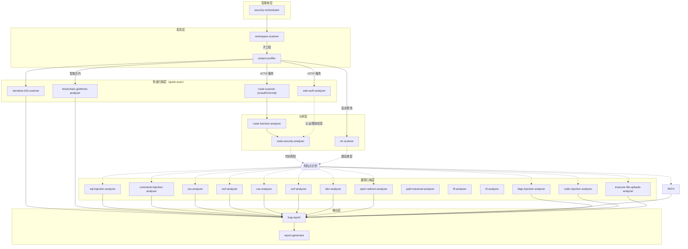

# Vul-AI-V2

基于 Claude Code 的自动化安全审计框架，通过 AI 智能体协作完成代码安全扫描。

## 核心能力概览

- 基于 tree-sitter 的快速扫描脚本（quick-scan）：
  - 路由扫描：`unauth-route-scanner`（未授权路由侧重）、`normal-route-scanner`（常规路由，软链复用同脚本）
  - 认证分析：`web-auth-analyzer`
  - 敏感信息扫描：`sensitive-info-scanner`
  - 工作区扫描：`workspace-scanner`
  - 项目画像：`project-profiler`
  - **智能合约审计**：`blockchain-goldmine-analyzer`（支持 Solidity、Rust、Move、Vyper、Go）
  - **AI 基础设施审计**：`model-loading-analyzer`（模型加载与权重反序列化）、`agent-config-analyzer`（智能体项目级配置与审批绕过）
- 自动化覆盖与人工分析的分工：脚本负责结构化提取与模式识别；风险分级、业务语义与复杂豁免规则需结合产物手动分析。

## 依赖与环境

- Python ≥ 3.9
- `tree-sitter`、`tree-sitter-language-pack`、`jq`、`git`、`bash`
- 一键检查：`bash ./check-dependencies.sh`（缺失项会给出安装提示）
- 第 08 阶段技能优化：本地固定检出 `third_party/SkillOpt`（0.2.0，提交 `01e41dbc`，MIT，要求 Python ≥3.10），核心依赖 `openai`、`pyyaml`；不启用 SkillOpt-Sleep、WebUI、插件或自动采用。

## 安装

```bash
# HTTPS 方式
git clone --recursive https://github.com/Clouditera/Vul-AI-V2.git

# SSH 方式
git clone --recursive git@github.com:Clouditera/Vul-AI-V2.git

# 已克隆后初始化子模块
git submodule update --init --recursive
```

## 快速开始

### 1. 链接配置到目标工程

```bash
cd /path/to/target-project
ln -s /path/to/Vul-AI-V2/.claude .claude
source .claude/skills/task-manage/scripts/setup.sh
```

### 2. 启动 Claude Code 并执行审计

```bash
claude
```

在 Claude Code 中输入：

```
@.claude/agents/security-orchestrator.md 审计当前项目
```

系统会自动调用 `security-orchestrator` 智能体进行全流程安全扫描。

### 3. 快速脚本示例（可单独运行）

```bash
# 路由扫描（未授权与常规，二者复用同脚本）
python3 .claude/skills/unauth-route-scanner/quick-scan.py . --output routes.md
# 认证分析
python3 .claude/skills/web-auth-analyzer/quick-scan.py . --output auth.md
# 敏感信息
python3 .claude/skills/sensitive-info-scanner/quick-scan.py . --output sensitive.md
# 智能合约审计建议（识别编程语言、推断应用场景、生成审计清单）
python3 .claude/skills/blockchain-goldmine-analyzer/quick-scan.py . --output contract-audit.md
# 模型加载信任边界（trust_remote_code / auto_map / torch.load）
python3 .claude/skills/model-loading-analyzer/quick-scan.py <repo> [<repo> ...]
# 智能体项目级配置与审批绕过（.mcp.json / .codex / Git 信任链）
python3 .claude/skills/agent-config-analyzer/quick-scan.py <repo> [<repo> ...]
# 输出 JSON
python3 .claude/skills/unauth-route-scanner/quick-scan.py . --json --output routes.json
```

> 说明：路由脚本不做认证判定；认证与风险分级需结合路由和上游产物手动分析。

### 4. 工作流速览（从发现到报告）

**Web 应用工作流**：
```
workspace-scanner → project-profiler → route-scanner（unauth/normal） → web-auth-analyzer → sensitive-info-scanner → report-generator
```

**智能合约工作流**：
```
workspace-scanner → project-profiler → blockchain-goldmine-analyzer → report-generator
```

**AI 基础设施工作流**（按项目特征条件触发）：
```
workspace-scanner → project-profiler
    ├─ 含 transformers/torch/vllm/sglang/verl → model-loading-analyzer
    ├─ 含 .mcp.json/.codex/AGENTS.md/审批逻辑 → agent-config-analyzer
    └─ → report-generator
```

各快速扫描产物可直接作为后续分析输入：
- Web 应用：路由清单 → 认证分析 → 敏感信息 → 报告聚合
- 智能合约：合约识别 → 审计建议 → 报告聚合
- AI 基础设施：项目画像 → 模型加载与智能体配置分析 → 报告聚合

## 批量审计看板

`ui/` 提供一个读取 `runs/*/*/audit-report.json` 的本地看板，采用中性浅色、细边框和清晰状态色；支持看板、表格、项目地图、持续监控与系统架构视图。

```bash
bash scripts/ui/start.sh
# http://127.0.0.1:8787

# 可选：启动自动流转（triage -> verify -> reproduce/closed，reproduce -> 红队 -> review）
bash scripts/workflow/flow_worker.sh start
```

- 六个阶段：未处理候选 / 分诊 / 待验证 / CVE 跟踪 / 待验收 / 已关闭。
- 审计运行：首页“正式执行链”固定展示环境构建、安全审计编排、攻击场景设计、蓝队验证、红队场景构建、红队执行、独立审核和经验学习八个节点，分别读取最新一次运行的真实产物，区分已完成、降级、受阻、失败、运行中、未开始和已跳过；项目筛选可切换查看对象。点击任一节点可查看对应的只读执行轨迹，多次调用可按轮次、候选或红队运行选择；原生 Claude 流式日志复用第三方 Claude Code 会话界面，旧文本日志和红队独立模型循环分别展示文本与结构化轨迹，不混为 Claude 会话。正在执行的一次审计运行（run）会在看板顶部显示实时状态条，打开后也可查看同一执行链，或切换到 CCUI 对话和“智能体拓扑”查看内部并行分派关系。运行视图不会自动重新加载嵌入页面；有新轨迹时只显示“有新内容 · 更新”按钮，避免阅读位置被刷新打断。
- 阶段技能学习：第 08 阶段读取八阶段反馈、覆盖记录、复审计划和验证结果，先归因再选择目标；需要重写时由宿主机调用本地 SkillOpt 核心重写入口生成候选，再由现有评估、发布和回退入口决定是否生效。未配置可信评估套件时只保留候选，不宣称能力已经提高。
- 卡片：严重度、源码级成立/误报/重复（TP/FP/DUP）、CVE 分级和证据数；点击卡片或使用键盘打开详情，在详情中修改状态与判定。
- 详情：摘要、证据和智能体输出；可查看原始报告、证据路径和 `claude.rendered.log` 尾部。
- 筛选：目标、严重度、判定、仅显示 CVE 候选和关键词搜索；默认展示全部候选问题（finding），不再分精选、CVE 和全部三档。
- 多轮审计发现记录表：`finding_ledger.py` 扫描全部完整有效报告，为每次发现的候选问题保留单独编号，并归并多轮审计中的同一问题；编号相同但含义不同的问题不共用状态，历史报告中独有的问题也会保留，运行中草稿不替代完整报告。
- 自动流转：`scripts/workflow/flow_worker.py` 读取 `triage` 和 `reproduce` 状态，调用第 4 阶段验证（`verify-agent`）、补充图文报告并执行第 5 阶段红队验证，把真实结果写入 `ui/data/flow-state.json`；`build_state.py` 继续合并发现记录表、验证结果以及 CVE 交接与裁定产物，生成 `ui/data/auto-state.json`。人工状态仍优先，含义有歧义的旧编号不猜测继承。
- 自动分类：按来源哈希（`source_hash`）自动评分和重算，出现新的 `confirmed` 验证结论时可触发已归档项重新评估；未达到通过条件的条目进入未处理候选（`inbox`）并默认隐藏，高危弱指纹不会直接归档。
- 自动流转默认每轮处理 1 条、最多尝试 1 次；环境缺失、验证结论为 `blocked` 或 `inconclusive`，以及红队未通过时都会保留明确状态，不伪造 `confirmed` 结论。CVE 跟踪仍由人工或 CVE 裁定产物推进。`FLOW_WORKER=1` 才会随看板启动，默认关闭以避免意外消耗模型；缺少环境时可设 `FLOW_BUILD_ENV=1`，让后台处理任务先执行第 0 阶段环境构建。
- 动态验收：红队捕获的随机标记（flag）必须有真实工具输出形成的证据来源链（provenance），独立审核（judge）按固定结构通过后才具备资格；进入人工待验收还要求图文报告和场景图。
- 手工状态写入 `ui/data/state.json`，不改原始报告；人工复核种子在 `ui/data/curated.json`，自动路由缓存不提交。
- 默认只监听 `127.0.0.1`，避免把未修复漏洞细节暴露到网络。

详见 `docs/system-architecture.md`、`ui/README.md`、`docs/refine-pipeline.md`、`docs/redteam-validation.md`、`docs/cve-candidates.md`、`docs/cve-handoff.json`。

## 项目地图与视觉报告

`project-cartographer` 技能把项目结构、审计覆盖和漏洞证据整理成可读的树和案例卡片：

```bash
python3 .claude/skills/project-cartographer/scripts/build_visual_model.py --project aud-048-opensandbox
python3 .claude/skills/project-cartographer/scripts/render_diagrams.py \
  --model runs/aud-048-opensandbox/20261028T080748Z/visual/visual-model.json \
  --out-dir runs/aud-048-opensandbox/20261028T080748Z/visual-rendered
```

产物：
- `visual-model.json`：项目结构树、审计覆盖树、攻击路径树，以及每个攻击的攻击者与受害者场景步骤
- `visual-rendered/*.svg`：结构图、覆盖图、攻击路径、攻击者与受害者双栏步骤图
- `report-illustrated.md`：带图报告，包含场景插图、双方执行步骤和证据
- `docs/visuals/*.webp`：image2 封面、章节和攻击场景插图，不充当漏洞证据

攻击场景插图可用 `render_attack_images.py --model ... --max 3` 生成；`--all` 为每个严重或高危攻击生成。

`run.sh` 现在默认在报告完整性检查后执行 `scripts/mine/visual_report.sh`：生成 `report-illustrated.md`，并优先由 `attack-scene-director` 生成 `scene-*.webp`；智能体辅助生成失败时，改用 image2 模板批处理。无需再手动设置 `VISUAL_RENDER=1` 或 `VISUAL_IMAGES=1`，这两个变量仍保留给旧的一次性容器路径。可用 `--skip-visual` 跳过，`--visual-max` 控制场景数量。

看板首页提供轻量 **自动分类流程**：未处理候选、分诊、待验证、CVE 跟踪、待验收和已关闭的实时计数，以及严重度和判定筛选；叙事插图只保留在项目地图与图文报告中。

看板的 **项目地图** 视图读取 `visual-model.json`，可以点击节点直接跳到对应候选问题。
360 平台已验证 `openai/gpt-image-2` 等图像模型；密钥从 opencode 配置读取，不写入数据库。

## 整夜并行批量审计（第 3 阶段）

在 Docker 外由宿主机脚本编排：克隆目标源码 → 5 个项目并行 → 每个项目不超过 24 小时 → 产出可读过程日志与报告。
默认模型 `360-proxy/deepseek/deepseek-v4.1-flash`，默认并发 5，超时 86400 秒。

### 今晚怎么跑

```bash
# 0) 依赖与产物校验自检（不启动任何批量审计）
bash ./check-dependencies.sh
bash scripts/mine/verify.sh --allow-empty

# 1) 克隆 5 个目标（codex / deepseek-harness / vllm / sglang / verl）
bash scripts/mine/clone_targets.sh            # 先加 --dry-run 看计划
cat targets/manifest.json                     # 记录 url / commit / clone_time

# 2) 预览整夜计划（不创建目录、不调用模型）
bash scripts/mine/overnight.sh start --dry-run

# 3) 启动（setsid + nohup 后台运行，立即返回 PID 与日志路径）
bash scripts/mine/overnight.sh start
```

API 密钥只从环境变量读取，不写入仓库、日志或 `run-meta.json`；启动前会自动检查磁盘余量（默认 ≥20G）与单实例锁。

### 明早看哪里

```bash
bash scripts/mine/overnight.sh status                 # running / completed / failed / pending
tail -f runs/.orchestrator/logs/orchestrator.log     # 编排器日志
tail -f runs/.orchestrator/logs/<project>.log        # 单项目实时日志

# 每个项目的报告与过程日志
runs/<project>/<timestamp>/audit-report.md
runs/<project>/<timestamp>/audit-report.json
runs/<project>/<timestamp>/claude.rendered.log
runs/<project>/<timestamp>/raw.jsonl
runs/<project>/<timestamp>/run-meta.json

# 产物完整性与密钥泄漏校验
bash scripts/mine/verify.sh
```

失败或超时后只补未完成项目：`bash scripts/mine/overnight.sh resume`；人工止损：`bash scripts/mine/overnight.sh stop`。
完整说明见 `docs/overnight-run.md`、`docs/docker-claude-mining.md`、`docs/docker-smoke-test.md`。

## 安全编排智能体（Security Orchestrator）

核心编排智能体，负责统筹项目分类并协调子智能体执行安全扫描任务。

### 输入参数

| 参数 | 必填 | 说明 |
|------|------|------|
| 代码仓库 | 是 | 当前工作目录 |
| 扫描器白名单 | 否 | 指定启用的扫描器，如"只启用 sql-injection-analyzer" |
| 扫描器黑名单 | 否 | 指定禁用的扫描器，如"禁用 sensitive-info-scanner" |
| `SCAN_RANGE` | 否 | 子工程分析范围，如"分析前10个子工程"，默认分析前 5 个 |

### 执行流程

```
STEP 1: 工作区扫描 (workspace-scanner)
    ↓
    判断单一项目 / 多子工程仓库
    ↓
STEP 2: 项目画像 (project-profiler)
    ↓
    识别技术栈、项目类型（后端服务 / 前端应用 / 智能合约 / 安全靶场）
    ↓
STEP 3: 条件化分析
    ├─ 后端 HTTP 服务 → 路由扫描 → 认证分析 → 敏感信息扫描 → 漏洞扫描
    ├─ 智能合约项目 → blockchain-goldmine-analyzer → 审计建议生成
    ├─ 前端 Web 应用 → 跳过（暂不分析）
    └─ 安全测试靶场 → vtr-scanner → 靶场分析
    ↓
STEP 4: 报告生成 (report-generator)
    ↓
    输出 audit-report.md / audit-report.json
```

### 可被显式调用的扫描器

下表中的技能可在提示词中显式指定，或由 `code-security-analyzer` 的风险点映射触发；**不代表全部会被自动调度**。

| 扫描器 | 检测能力 |
|--------|----------|
| `sql-injection-analyzer` | SQL 注入 |
| `xss-analyzer` | 跨站脚本攻击 |
| `command-injection-analyzer` | 命令注入 |
| `code-injection-analyzer` | 代码注入 |
| `ssrf-analyzer` | 服务端请求伪造 |
| `xxe-analyzer` | XML 外部实体注入 |
| `csrf-analyzer` | 跨站请求伪造 |
| `idor-analyzer` | 不安全的直接对象引用 |
| `path-traversal-analyzer` | 路径遍历 |
| `lfi-analyzer` | 本地文件包含 |
| `rfi-analyzer` | 远程文件包含 |
| `open-redirect-analyzer` | 开放重定向 |
| `ldap-injection-analyzer` | LDAP 注入 |
| `xpath-injection-analyzer` | XPath 注入 |
| `http-header-injection-analyzer` | HTTP 头注入 |
| `insecure-file-uploads-analyzer` | 不安全文件上传 |
| `sensitive-info-scanner` | 敏感信息泄露 |
| `authentication-analyzer` | 认证机制缺陷 |
| `model-loading-analyzer` | 模型加载远程代码与权重反序列化 |
| `agent-config-analyzer` | 智能体项目级配置信任、审批绕过与 Git 信任链 |

### 自动调度路径

| 项目类型 | 自动追加的技能 | 触发位置 |
|----------|----------------|----------|
| 后端 HTTP 服务 | `web-auth-analyzer`、`sensitive-info-scanner` | `project-profiler` |
| 智能合约 | `blockchain-goldmine-analyzer` | `project-profiler` |
| 安全靶场 | `vtr-scanner` | `project-profiler` |
| 含 transformers/torch/vllm/sglang/verl 特征 | `model-loading-analyzer` | `project-profiler` 条件推荐与编排智能体条件任务 |
| 含 `.mcp.json` / `.codex` / `AGENTS.md` / 审批逻辑 | `agent-config-analyzer` | 同上 |

> `project-profiler` 的「禁止添加其他技能」仅约束对应分类的基础列表；AI 基础设施条件任务由编排智能体在画像之后按特征追加，见 `.claude/agents/security-orchestrator.md`。

### 输出产物

```
.workspace/
├── tasks/
│   └── security-orchestrator-tasks.json  # 任务清单
├── results/                               # 扫描结果
├── findings/                              # 漏洞发现
│   ├── coverage-ledger.json               # 覆盖与假设记录
│   ├── coverage-plan.json / .md           # 下一批检查任务
│   ├── review-plan.json / .md             # 有理由的复审计划
│   └── hypotheses/                        # 单条假设的证据与缺口
└── reports/
    ├── audit-report.md                    # 可读报告
    └── audit-report.json                  # 机器可读报告
```

### 使用示例

```
# 完整扫描
@.claude/agents/security-orchestrator.md 审计当前项目

# 指定扫描器
@.claude/agents/security-orchestrator.md 只使用 sql-injection-analyzer 和 xss-analyzer 进行扫描

# 多子工程仓库指定分析范围
@.claude/agents/security-orchestrator.md 安全审计，分析前10个子工程

# 排除特定扫描器
@.claude/agents/security-orchestrator.md 安全审计，禁用 sensitive-info-scanner
```

## 快速脚本与技能速览表

| 脚本 | 主要用途 | 输入 | 输出 | 语言/框架示例 | 不做的事 |
|------|---------|------|------|--------------|---------|
| unauth/normal-route-scanner | 提取路由注册（含方法、路径、处理函数和位置） | 代码目录 | routes.md / routes.json | Go(gin/mux/echo/chi)、Node(Express/Nest/Koa/Fastify)、Python(Flask/FastAPI)、Java(Spring) 等 | 不做认证判定与风险分级 |
| web-auth-analyzer | 认证与豁免配置提取 | 代码目录 | auth.md / auth.json | 主流 Web 框架 | 业务逻辑级别的授权判断需人工 |
| sensitive-info-scanner | 硬编码敏感信息、泄露函数探测 | 代码目录 | sensitive.md / sensitive.json | Go、Node、Python、Java 等；支持 Go env/os.Getenv | 业务语义确认需人工 |
| workspace-scanner | 目录与子工程识别 | 工作区 | 结构化清单 | 通用 | 风险判定需下游 |
| project-profiler | 技术栈画像、推荐扫描器 | 子工程 | 画像结果 | 通用 | 风险判定需下游 |
| audit-coverage-planner | 识别入口、危险操作、信任边界、权限和配置条件，规划下一批检查 | 项目画像、知识卡、Jev 初筛 | 覆盖记录、假设清单、覆盖计划 | 通用 | 不执行扫描，不声称全仓库覆盖率 |
| audit-hypothesis-tracer | 围绕单一假设补齐调用链、可达性、防护和影响证据 | 覆盖条目、源码、知识卡 | 更新后的覆盖记录、假设文件 | 通用 | 不把静态命中当漏洞 |
| audit-review-planner | 按新条件或预算内随机复查安排旧区域复审 | 覆盖记录、历史尝试、技能版本 | 复审计划、复审任务 | 通用 | 不把重复报告算新增收益 |
| **blockchain-goldmine-analyzer** | **合约编程语言识别、应用场景推断、审计建议生成** | **合约项目** | **audit-profile.md** | **Solidity、Rust、Move、Vyper、Go** | **不做深度审计，仅提供审计方向和清单** |

## 任务管理提示

- `task-manage/scripts/tools/update-task.sh`：任务标记为 `completed` 时，自动提示索引靠后的下一个 `pending` 任务。

## 技能推荐关系图



### 推荐关系说明

| 上游技能 | 下游技能 | 触发条件 |
|---------|---------|---------|
| workspace-scanner | project-profiler | 每个子工程 |
| project-profiler | route-scanner | HTTP 服务类型 |
| project-profiler | authentication-analyzer | HTTP 服务类型 |
| project-profiler | **blockchain-goldmine-analyzer** | **智能合约类型** |
| project-profiler | vtr-scanner | 安全靶场类型 |
| route-scanner | route-function-analyzer | 每个路由文件 |
| route-function-analyzer | code-security-analyzer | 每个 API 端点 |
| code-security-analyzer | 漏洞分析器 | 根据代码风险点激活 |
| **blockchain-goldmine-analyzer** | **bug-report** | **生成审计建议** |
| vtr-scanner | 漏洞分析器 | 根据靶场题目类型推荐 |
| 漏洞分析器 | bug-report | 发现漏洞时 |

## 智能体知识驱动审计（执行框架、推理引擎与训练框架）

GoldMine 不再把规则扫描器当结论，而是结合轻量索引、知识库、智能体推理和验证结果回写：

```text
project-profiler --json（轻量画像）
  → knowledge/project-types/<type>.md + knowledge/projects/<project>.md
  → 第 1 波：infra-analyst × 6（config / process-exec / mcp / sandbox / control-plane / filesystem 并行读代码，使用原生 `Grep`、`Glob`、`Skill`）
  → 第 2、3 波：audit-skill-worker × 最多各 6（按 recommended_skills 和覆盖缺口选择技能，由原生 Skill 加载传统分析技能）
  → hypothesis-critic（按 root cause/aliases 去重、跨边界链校准）
  → report-generator（canonical findings）
  → 宿主 run.sh：visual_report → verify-agent（Top Critical/High）
  → 宿主 run.sh：redteam batch/judge（仅通过验证的 Top findings）
  → knowledge-scribe（confirmed/rejected 回写 knowledge/）
  → 第 6 阶段：红蓝经验 → 共享/仓库专属修复候选
  → 独立前后运行评估 → 发布规则 → 下一次挖掘加载
```

安全审计编排最多执行 3 波、共 18 个分析任务；第 2、3 波只在覆盖记录仍有缺口时启动，没有新增缺口时停止。传统分析技能由原生 Skill 工具实际加载，`skill-runner` 只作为兼容入口保留，不再是安全审计的默认技能加载器。受阻或失败的分析任务保留原因并计入批次汇总，任务数量不代表已验证召回率，也不会自动发布候选或修复。

新增智能体：

- `.claude/agents/infra-analyst.md`
- `.claude/agents/audit-skill-worker.md`
- `.claude/agents/hypothesis-critic.md`
- `.claude/agents/knowledge-scribe.md`
- `.claude/agents/diff-auditor.md`（单次提交的供应链审查）

知识库：

```text
knowledge/
  project-types/   agent-harness / inference-engine / training-framework / model-serving
  projects/        vllm / sglang / verl / codex / deepseek-harness
  project-rules/   经独立评估发布的仓库专属挖掘修复
  playbooks/       evidence-first / reachability
  cves/            CVE 卡片格式
  false-positives/ 误报模式
  cases/           每次审计的 confirmed/rejected
```

原则：代码只负责索引、统计、环境和验证，判断交给智能体；每次审计后由 `knowledge-scribe`
把新入口、配置开关、验证配方和误报写回知识库。`scripts/experimental/infra_surface_index.py`
是可选索引，不产出正式候选问题。

## RSI：验证资源学习与挖掘修复

验证资源学习（Verification-RSI）保留单次观测身份（occurrence）、同一问题编号（semantic）、动作前特征、动作与标注倾向、证据等级和实际动作收益；支持分层标注、成本与收益评估训练、基线方案回放、统计通过条件和只读建议模式（shadow），不会把未验证策略直接用于生产审计。当前训练支持 91 条均为静态证据（static），可用于动作训练的可信样本（trusted）为 0；回放状态为 `insufficient`，因此验证动作仍只生成建议。

```bash
python3 -m audit_rsi experience-build --runs runs --output rsi/verification-experience.jsonl
python3 -m audit_rsi label-sample --pool rsi/verification-experience.jsonl --output rsi/verification-label-sample.jsonl --limit 100
# 人工标注后：label-merge → verify-train → verify-shadow / verify-replay
```

挖掘修复学习已接入主流程。单项目 `run.sh` 在第 6 阶段通过 `Claude Code` 启动 `mining-repair-learner`，由它组合验证经验分析、作用域判断、证据优先、可达性、误报模式、项目知识和按类别选择的现有分析技能，把修复写成 `rsi/mining-repairs/agentic/*.md`。主流程再把候选写入独立上下文，自动重新执行挖掘、蓝队验证和红队审核，根据真实候选运行决定发布或拒绝。批量 `parallel_mine.sh` 会进一步汇总多个项目，自动选择未参与来源训练的留出项目重跑共享候选。候选运行位于 `rsi/mining-repairs/attempt-runs/`，不会混入正式 `runs/` 历史；无需人工执行离线学习命令。

共享规则写入 `.claude/skills/rsi-shared-experience/rules/`，至少需要两个可信来源项目和一个未参与训练的留出项目；项目规则写入 `knowledge/project-rules/<project>/`，只对当前项目生效。误报修复必须降低误报率、至少抑制一个既有误报，同时不得丢失正确结论或引入新误报。发布后的规则由下一次挖掘实际加载，每个版本都可回滚。

```bash
# 正常主流程自动完成仓库专属候选、隔离重跑、红蓝验证和评估发布
bash run.sh /path/to/source

# 批量主流程自动完成共享候选的留出项目重跑与评估
bash scripts/mine/parallel_mine.sh

# 仅用于查看实际加载规则或回滚活动版本
python3 -m audit_rsi mining-repair-context --project <project>
python3 -m audit_rsi mining-repair-rollback --version <mrv_...>
```

数据或留出验证集（holdout）不足时输出 `insufficient`，验证建议恢复基线方案，挖掘修复保持候选状态；回放和真实前后对照都不宣称因果提升。完整命令和数据契约见 `docs/system-architecture.md` 第 10 节。

## 完整流水线：`run.sh`

`run.sh` 现在串起第 0 阶段环境构建、批量审计、图文报告、第 4 阶段候选验证、第 5 阶段红队批量执行与独立审核，以及第 6 阶段候选重跑和挖掘修复发布：

```bash
bash run.sh /path/to/source
```

阶段与产物：

| 阶段 | 动作 | 日志/产物 |
|---|---|---|
| 第 0 阶段 | `phase0_env.sh` 默认通过 `build_env_agent.sh` 启动智能体主导构建，`build_env.sh` 作为确定性工具或备用方案 | `env/<project>/env-manifest.json`、`<run>.meta/env-build.log`、`<run>.meta/env-build-agent-*.log`、`<run>.meta/env-phase.json` |
| 批量审计 | 在持久沙箱内使用 Claude Code 审计 | `<run>/claude.rendered.log`、`audit-report.md/json`、`<run>.meta/sandbox.json` |
| 视觉报告 | `visual_report.sh` 生成图文报告与攻击场景图 | `<run>/visual-rendered/report-illustrated.md`、`scene-*.webp`、`visual-summary.json` |
| 第 4 阶段 | `verify-agent` 为优先检查候选问题编写验证程序（harness），并由隔离的 `run_verify.sh` 执行 | `<run>/verify/agent/summary.md`、`<run>.meta/verify.log` |
| 第 5 阶段 | 红队 `batch.py` 构建隔离环境、按候选并行运行攻击端，再由独立 `judge.py` 审核 | `<run>/redteam/summary.md`、`<run>.meta/redteam.log` |
| 第 6 阶段 | `Claude Code` 学习节点组合多个技能生成修复 `Markdown`，`mining-repair-drive` 在独立目录重跑挖掘与红蓝验证；接受项发布并由下一轮加载 | `<run>/rsi/learner.jsonl`、`driver.json`、`rsi/mining-repairs/agentic/` |

批量审计后可以继续进入同一 `/workspace/repo` 调试和验证，不必重新搭环境：

```bash
bash scripts/env/sandbox.sh status --project <project> --run-dir <run>
bash scripts/env/sandbox.sh shell --project <project> --run-dir <run>
bash scripts/env/sandbox.sh isolate --project <project> --run-dir <run>
bash run.sh --verify-only <run>
```

`stop` 只停止并保留沙箱，`remove` 才删除容器。`PERSIST_SANDBOX=0` 可恢复一次性审计容器；沙箱创建失败或恢复审计运行时无法共享挂载，都会自动回退到独立容器。

常用开关：

```bash
bash run.sh <source> --skip-env --skip-verify --skip-visual --skip-redteam --skip-mining-repair  # 只进行批量审计
bash run.sh <source> --mine-only                # 等价于上面
bash run.sh <source> --skip-mining-repair       # 完成红蓝验证，但跳过经验与修复候选生成
bash run.sh <source> --env-mode full --timeout 86400
bash run.sh <source> --env-agent on --env-agent-rounds 2 --env-agent-timeout 2400
bash run.sh <source> --env-agent off          # 明确关闭智能体，只运行确定性备用方案
bash run.sh <source> --verify-max 10 --verify-severity critical,high
bash run.sh <source> --skip-visual              # 跳过图文，仍执行候选验证与红队
bash run.sh <source> --skip-redteam             # 跳过红队批量执行与独立审核
bash run.sh <source> --visual-max 8 --redteam-max 8
bash run.sh --status <run_dir>                  # 同时显示 env_status / visual_status / verify_agent_status / redteam_status / review_ready
bash run.sh --stop   <run_dir>                  # 停止审计与验证容器
```

`scripts/verify/auto_verify.sh` 仍保留为手工静态预筛，只输出 `inconclusive` 或 `blocked`；
`run.sh` 的第 4 阶段不再调用它，而是调用 `scripts/verify/phase4_verify_agent.sh`，由真实
`verify-agent` 编写验证程序，再交给 `run_verify.sh` 在断网容器中执行。

## 第 0 阶段：环境构建（智能体主导与确定性备用）

`run.sh` 的第 0 阶段默认由环境构建智能体主导：

1. **智能体主导构建**：`scripts/env/build_env_agent.sh` 直接启动 `environment-builder`，由智能体检查源码、选择构建方式、读取日志、修正 Dockerfile 并验收运行环境。
2. **确定性构建工具**：`scripts/env/build_env.sh` 提供 `auto/editable/requirements/full/none` 构建能力，由智能体按需调用，不再抢在智能体之前执行。
3. **确定性备用方案**：智能体不可用或没有产出可用环境时才执行备用方案；每轮可用的智能体结果会保存快照，后续轮次失败时恢复最佳结果。

```bash
# 默认：直接由智能体构建环境
bash run.sh targets/vllm --env-mode auto

# 由智能体执行多轮构建与改进
bash run.sh targets/vllm --env-agent on --env-agent-rounds 2

# 明确关闭智能体，只运行确定性备用方案
bash run.sh targets/vllm --env-agent off
```

产物：`env/<project>/{Dockerfile,build.sh,run.sh,test.sh,env-manifest.json,build.log}`，
镜像：`mygoldmine/env:<project>-<commit>`；第 0 阶段汇总在
`<run>.meta/env-phase.json`，智能体日志为 `<run>.meta/env-build-agent-<round>.log`。
`env-phase.json` 会记录运行时前提：`claude_available`、`skill_available`、`script_available`、`missing`、`agent.reason`；`status.json` 和 `run.sh --status` 同步显示 `env_agent_status` 与 `env_agent_reason`。
`env_status` 为 `ready`、`partial` 或 `blocked`，失败不会标记为 `ready`。

底层仍可单独调用：

```bash
bash scripts/env/build_env.sh targets/vllm --dry-run
bash scripts/env/build_env.sh targets/vllm --mode auto
bash scripts/env/phase0_env.sh targets/vllm --mode auto --meta-dir /tmp/phase0 --agent auto
```

## 第 4 阶段：候选问题验证（`verify-agent`）

`run.sh` 默认对报告中的严重或高危候选问题调用真实 `verify-agent`：

```bash
bash scripts/verify/phase4_verify_agent.sh \
  --project vllm \
  --run-dir runs/vllm/20261027T023629Z \
  --image mygoldmine/env:vllm-20bf65a \
  --source targets/vllm \
  --max 10 --severity critical,high \
  --timeout 300 --agent-timeout 900 \
  --claude-bin claude --model deepseek/deepseek-v4.1-flash \
  --output runs/vllm/20261027T023629Z/verify/agent
```

`verify-agent` 编写最小、非武器化验证程序；封装脚本再调用 `run_verify.sh` 在隔离容器执行。
结果写到 `verify/agent/<finding-id>/verify-report.json`，汇总在 `verify/agent/summary.json`。
输出四种验证结论：`confirmed`、`rejected`、`inconclusive` 和 `blocked`。默认使用 `--network none`、非 root 用户、
`cap-drop`、内存、CPU 和超时限制，不挂载 Docker 套接字；无法产出有效报告时记录 `blocked`，不伪造 `confirmed` 结论。

## 第 5 阶段：红队批量执行与独立审核

图文报告之后，`run.sh` 默认把当前审计运行中的严重或高危候选问题送入红队：

```bash
bash scripts/redteam/phase5_redteam.sh \
  --project vllm --run-dir runs/vllm/20261027T023629Z \
  --max 5 --severity critical,high \
  --model flint --base-url http://100.81.81.75:8081/v1 \
  --judge-claude claude --judge-claude-model deepseek/deepseek-v4.1-flash \
  --output runs/vllm/20261027T023629Z/redteam
```

它复用 `batch.py` 构建隔离环境、运行攻击端并调用 `judge.py`；只有真实工具输出捕获随机标记
且独立审核结论为 `approved`，才进入待人工验收队列。场景构建器支持 HTTP 服务、固定命令行和进程内库调用三种执行原语，库调用和命令行场景由攻击者提供 `/input` 输入，受害端只执行场景固定入口。失败、`blocked` 或审核结论为 `rejected` 时都保留结构化状态，受阻交付使用 `blocked.json`。

两个智能体定义在 `.claude/agents/environment-builder.md` 和 `.claude/agents/verify-agent.md`。

## 系统语言

在 `config/system.json` 设置 `language`（`zh` / `en`），或在看板左下角齿轮里切换。提示词会通过 `scripts/config/language.py --prompt` 自动注入，详见 `docs/language.md`。

## 持续监控（Claude Security 模式）

连接仓库后按提交持续审查变化，而不是每次人工重跑全仓库：

```bash
python3 scripts/watch/watch.py add --project codex --path targets/codex
python3 scripts/watch/watch.py poll --fetch
python3 scripts/watch/watch.py brief
```

每次更新生成 `runs/watch/<project>/<sha>.md`，按 `critical`、`high`、`review` 和 `low` 排序；
高风险项进入 `runs/watch/queue/`，由派发器绑定项目、分支和 commit 后自动调用 `run.sh` 深度审计。
看板“自动狩猎”页读取 `ui/data/watch-state.json`，并显示监控分支、commit 和派发状态。
规则、常驻方式和边界见 `docs/continuous-watch.md`。

## 测试与报告质量

```bash
# 前端单元测试：阶段计数、待人工验收条件归属、未处理候选只展开 inbox
cd ui && npm test

# 系统测试：自动启动服务和无界面 Chrome，验证流程计数、阶段切换和项目筛选联动
cd ui && npm run test:system

# 报告字段与语言完整性
pytest -q tests/test_report_quality.py tests/test_check_report.py
python3 scripts/workflow/report_quality.py
python3 scripts/workflow/report_quality.py --fail --fail-language
python3 scripts/mine/check_report.py --report runs/<project>/<run>/audit-report.json --fail-missing --fail-language
```

`report_quality.py` 输出 `ui/data/report-quality.json` 和 `runs/report-quality.md`；
系统语言为中文时，英文 `title` 会标记为 `titleLanguage` 缺失，不再静默进入分诊或待验证。

## 目录结构

```
.claude/
├── agents/
│   └── security-orchestrator.md    # 编排智能体
├── skills/
│   ├── workspace-scanner/          # 工作区扫描
│   ├── project-profiler/           # 项目画像（识别项目类型）
│   ├── route-scanner/              # 路由扫描
│   ├── route-function-analyzer/    # 路由功能分析
│   ├── code-security-analyzer/     # 代码安全分析
│   ├── blockchain-goldmine-analyzer/   # 🆕 智能合约审计建议
│   ├── model-loading-analyzer/         # 🆕 模型加载/权重反序列化
│   ├── agent-config-analyzer/          # 🆕 智能体配置信任与审批绕过
│   ├── bug-report/                 # 漏洞报告模板
│   ├── report-generator/           # 报告生成
│   ├── blockchain_goldmine/        # 智能合约知识库（Git 子模块）
│   └── TOP40+/                     # 漏洞扫描器
│       ├── sql-injection-analyzer/
│       ├── xss-analyzer/
│       ├── command-injection-analyzer/
│       └── ...
```

## 许可证

MIT

异常退出后的产物保留、超时与恢复未完成项目见 [批量审计异常恢复](docs/durable-recovery.md)。

### 沙箱源码准备与复用

沙箱创建操作按运行目录加锁，容器启动后同步复制源码，复制成功才写入工作副本就绪标记并返回。持久沙箱中的审计入口检查就绪标记后直接复用工作副本，不再清空或二次复制；停止后再次启动保留已有修改。复制失败不发布就绪状态，并停止新建容器。旧版或未准备完成的沙箱缺少标记时拒绝启动审计，需用新的运行目录重建，原工作副本保留。独立临时容器仍由入口准备源码，清理失败会直接报错。
