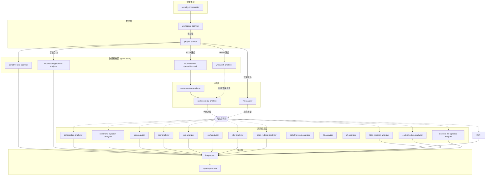

# Vul-AI-V2

基于 Claude Code 的自动化安全审计框架，通过 AI 智能体协作完成代码安全扫描。

## 核心能力概览

- 基于 tree-sitter 的快速扫描脚本（quick-scan）：
  - 路由扫描：`unauth-route-scanner`（未授权路由侧重）、`normal-route-scanner`（常规路由，软链复用同脚本）
  - 认证分析：`web-auth-analyzer`
  - 敏感信息扫描：`sensitive-info-scanner`
  - 工作区扫描：`workspace-scanner`
  - 项目画像：`project-profiler`
  - **智能合约审计**：`blockchain-goldmine-analyzer`（支持 Solidity、Rust、Move、Vyper、Go）
  - **AI 基础设施审计**：`model-loading-analyzer`（模型加载/权重反序列化）、`agent-config-analyzer`（Agent 项目级配置与审批绕过）
- 自动化覆盖 vs 人工分析：脚本负责结构化提取与模式识别；风险分级、业务语义与复杂豁免规则需结合产物手动分析。

## 依赖与环境

- Python ≥ 3.9
- `tree-sitter`、`tree-sitter-language-pack`、`jq`、`git`、`bash`
- 一键检查：`bash ./check-dependencies.sh`（缺失项会给出安装提示）

## 安装

```bash
# HTTPS 方式
git clone --recursive https://github.com/Clouditera/Vul-AI-V2.git

# SSH 方式
git clone --recursive git@github.com:Clouditera/Vul-AI-V2.git

# 已克隆后初始化子模块
git submodule update --init --recursive
```

## 快速开始

### 1. 链接配置到目标工程

```bash
cd /path/to/target-project
ln -s /path/to/Vul-AI-V2/.claude .claude
source .claude/skills/task-manage/scripts/setup.sh
```

### 2. 启动 Claude Code 并执行审计

```bash
claude
```

在 Claude Code 中输入：

```
@.claude/agents/security-orchestrator.md 审计当前项目
```

系统会自动调用 `security-orchestrator` 智能体进行全流程安全扫描。

### 3. 快速脚本示例（可单独运行）

```bash
# 路由扫描（未授权/常规，二者复用同脚本）
python3 .claude/skills/unauth-route-scanner/quick-scan.py . --output routes.md
# 认证分析
python3 .claude/skills/web-auth-analyzer/quick-scan.py . --output auth.md
# 敏感信息
python3 .claude/skills/sensitive-info-scanner/quick-scan.py . --output sensitive.md
# 智能合约审计建议（识别编程语言、推断应用场景、生成审计清单）
python3 .claude/skills/blockchain-goldmine-analyzer/quick-scan.py . --output contract-audit.md
# 模型加载信任边界（trust_remote_code / auto_map / torch.load）
python3 .claude/skills/model-loading-analyzer/quick-scan.py <repo> [<repo> ...]
# Agent 项目级配置与审批绕过（.mcp.json / .codex / Git 信任链）
python3 .claude/skills/agent-config-analyzer/quick-scan.py <repo> [<repo> ...]
# 输出 JSON
python3 .claude/skills/unauth-route-scanner/quick-scan.py . --json --output routes.json
```

> 说明：路由脚本不做认证判定；认证与风险分级需结合路由/上游产物手动分析。

### 4. 工作流速览（从发现到报告）

**Web 应用工作流**：
```
workspace-scanner → project-profiler → route-scanner（unauth/normal） → web-auth-analyzer → sensitive-info-scanner → report-generator
```

**智能合约工作流**：
```
workspace-scanner → project-profiler → blockchain-goldmine-analyzer → report-generator
```

**AI 基础设施工作流**（按项目特征条件触发）：
```
workspace-scanner → project-profiler
    ├─ 含 transformers/torch/vllm/sglang/verl → model-loading-analyzer
    ├─ 含 .mcp.json/.codex/AGENTS.md/审批逻辑 → agent-config-analyzer
    └─ → report-generator
```

各 quick-scan 产物可直接作为后续分析输入：
- Web 应用：路由清单 → 认证分析 → 敏感信息 → 报告聚合
- 智能合约：合约识别 → 审计建议 → 报告聚合
- AI 基础设施：项目画像 → 模型加载 / Agent 配置分析 → 报告聚合

## 漏洞挖掘 Kanban UI

`ui/` 提供一个读取 `runs/*/*/audit-report.json` 的本地看板，交互参考 `claudecodeui` 的 workspace 组织方式，视觉按 `oil-ui` 的证据档案方向实现。

```bash
bash scripts/ui/start.sh
# http://127.0.0.1:8787
```

- 五列：收件箱 / 分诊 / 复现 / CVE 跟踪 / 已关闭。
- 运行中的 run 会在看板顶部出现 LIVE 条：显示状态、耗时、最后一行日志；点开可实时 tail `claude.rendered.log`（2 秒刷新）。`run.sh` 与 overnight/mine_one 都支持。
- 卡片：严重度、TP/FP/DUP、CVE Tier、证据数；原生拖拽改状态。
- 详情：Brief / Evidence / Agent stream；可看原始报告、证据路径、`claude.rendered.log` 尾部。
- 筛选：目标、严重度、判定、CVE-only、搜索；默认展示全部 finding，不再分精选/CVE/全部三档。
- 自动流转：`scripts/workflow/build_state.py` 读取 verify、CVE handoff/adjudication 和最新报告，生成 `ui/data/auto-state.json`；人工状态仍优先。
- 精炼漏斗：956 条原始 finding 自动评分，未达门槛的进“原始池”并默认隐藏；CVE 候选/已验证项进入“待验收”，人工只处理图文精品 case。
- 手工状态写入 `ui/data/state.json`，不改原始报告；人工复核种子在 `ui/data/curated.json`，自动路由缓存不提交。
- 默认只监听 `127.0.0.1`，避免把未修复漏洞细节暴露到网络。

详见 `ui/README.md`、`docs/refine-pipeline.md`、`docs/redteam-validation.md`、`docs/cve-candidates.md`、`docs/cve-handoff.json`。

## 项目地图与视觉报告

`project-cartographer` skill 把项目结构、审计覆盖和漏洞证据做成可读的树和 case card：

```bash
python3 .claude/skills/project-cartographer/scripts/build_visual_model.py --project aud-048-opensandbox
python3 .claude/skills/project-cartographer/scripts/render_diagrams.py \
  --model runs/aud-048-opensandbox/20261028T080748Z/visual/visual-model.json \
  --out-dir runs/aud-048-opensandbox/20261028T080748Z/visual-rendered
```

产物：
- `visual-model.json`：项目结构树、审计覆盖树、攻击路径树，以及每个攻击的 attacker / victim 场景步骤
- `visual-rendered/*.svg`：结构图、覆盖图、攻击路径、攻击者/受害者双栏步骤图
- `report-illustrated.md`：带图报告，包含场景插图、双方执行步骤和证据
- `docs/visuals/*.webp`：image2 封面/章节/攻击场景插图，不充当漏洞证据

攻击场景插图可用 `render_attack_images.py --model ... --max 3` 生成；`--all` 为每个 Critical/High 攻击生成。

流水线默认只生成 `visual-model.json`；需要审计结束即渲染时设置 `VISUAL_RENDER=1`，需要同时生成 attack 插图时再设置 `VISUAL_IMAGES=1`（可用 `VISUAL_IMAGE_MAX` 限制数量）。

推荐再加 `VISUAL_AGENTIC=1`：由 `attack-scene-director` 读取 finding/verify/源码证据，先写 attacker/victim 分镜和 prompt，再调用 image2；失败时回退到模板批处理。

看板顶部还有一条 **精炼管线 hero**：3D 风格炼厂概念图 + 原矿/分诊/复现/CVE 去重/验收实时计数。

UI 的 **项目地图** 视图读取 `visual-model.json`，可以点节点直接跳到 finding。
360 平台已验证 `openai/gpt-image-2` 等图像模型；密钥从 opencode 配置读取，不落库。

## 整夜并行挖掘（Phase 3）

在 Docker 外由宿主机脚本编排：克隆目标源码 → 5 项目并行 → 每项目 ≤ 6h → 产出可读过程日志与报告。
默认模型 `360-proxy/deepseek/deepseek-v4.1-flash`，默认并发 5，超时 21600 秒。

### 今晚怎么跑

```bash
# 0) 依赖与产物校验自检（不启动任何挖掘）
bash ./check-dependencies.sh
bash scripts/mine/verify.sh --allow-empty

# 1) 克隆 5 个目标（codex / deepseek-harness / vllm / sglang / verl）
bash scripts/mine/clone_targets.sh            # 先加 --dry-run 看计划
cat targets/manifest.json                     # 记录 url / commit / clone_time

# 2) 预览整夜计划（不创建目录、不调用模型）
bash scripts/mine/overnight.sh start --dry-run

# 3) 启动（setsid + nohup 后台运行，立即返回 PID 与日志路径）
bash scripts/mine/overnight.sh start
```

API key 只从环境变量读取，不写入仓库、日志或 `run-meta.json`；启动前会自动检查磁盘余量（默认 ≥20G）与单实例锁。

### 明早看哪里

```bash
bash scripts/mine/overnight.sh status                 # running / completed / failed / pending
tail -f runs/.orchestrator/logs/orchestrator.log     # 编排器日志
tail -f runs/.orchestrator/logs/<project>.log        # 单项目实时日志

# 每个项目的报告与过程日志
runs/<project>/<timestamp>/audit-report.md
runs/<project>/<timestamp>/audit-report.json
runs/<project>/<timestamp>/claude.rendered.log
runs/<project>/<timestamp>/raw.jsonl
runs/<project>/<timestamp>/run-meta.json

# 产物完整性与密钥泄漏校验
bash scripts/mine/verify.sh
```

失败或超时后只补未完成项目：`bash scripts/mine/overnight.sh resume`；人工止损：`bash scripts/mine/overnight.sh stop`。
完整说明见 `docs/overnight-run.md`、`docs/docker-claude-mining.md`、`docs/docker-smoke-test.md`。

## Security Orchestrator

核心编排智能体，负责统筹项目分类并协调子智能体执行安全扫描任务。

### 输入参数

| 参数 | 必填 | 说明 |
|------|------|------|
| 代码仓库 | 是 | 当前工作目录 |
| 扫描器白名单 | 否 | 指定启用的扫描器，如"只启用 sql-injection-analyzer" |
| 扫描器黑名单 | 否 | 指定禁用的扫描器，如"禁用 sensitive-info-scanner" |
| `SCAN_RANGE` | 否 | 子工程分析范围，如"分析前10个子工程"，默认分析前 5 个 |

### 执行流程

```
STEP 1: 工作区扫描 (workspace-scanner)
    ↓
    判断单一项目 / Monorepo
    ↓
STEP 2: 项目画像 (project-profiler)
    ↓
    识别技术栈、项目类型（后端服务 / 前端应用 / 智能合约 / 安全靶场）
    ↓
STEP 3: 条件化分析
    ├─ 后端HTTP服务 → 路由扫描 → 认证分析 → 敏感信息扫描 → 漏洞扫描
    ├─ 智能合约项目 → blockchain-goldmine-analyzer → 审计建议生成
    ├─ 前端WEB应用 → 跳过（暂不分析）
    └─ 安全测试靶场 → vtr-scanner → 靶场分析
    ↓
STEP 4: 报告生成 (report-generator)
    ↓
    输出 audit-report.md / audit-report.json
```

### 可被显式调用的扫描器

下表中的 skill 可在 prompt 中显式指定，或由 `code-security-analyzer` 的风险点映射触发；**不代表全部会被自动调度**。

| 扫描器 | 检测能力 |
|--------|----------|
| `sql-injection-analyzer` | SQL 注入 |
| `xss-analyzer` | 跨站脚本攻击 |
| `command-injection-analyzer` | 命令注入 |
| `code-injection-analyzer` | 代码注入 |
| `ssrf-analyzer` | 服务端请求伪造 |
| `xxe-analyzer` | XML 外部实体注入 |
| `csrf-analyzer` | 跨站请求伪造 |
| `idor-analyzer` | 不安全的直接对象引用 |
| `path-traversal-analyzer` | 路径遍历 |
| `lfi-analyzer` | 本地文件包含 |
| `rfi-analyzer` | 远程文件包含 |
| `open-redirect-analyzer` | 开放重定向 |
| `ldap-injection-analyzer` | LDAP 注入 |
| `xpath-injection-analyzer` | XPath 注入 |
| `http-header-injection-analyzer` | HTTP 头注入 |
| `insecure-file-uploads-analyzer` | 不安全文件上传 |
| `sensitive-info-scanner` | 敏感信息泄露 |
| `authentication-analyzer` | 认证机制缺陷 |
| `model-loading-analyzer` | 模型加载远程代码 / 权重反序列化 |
| `agent-config-analyzer` | Agent 项目级配置信任 / 审批绕过 / Git 信任链 |

### 自动调度路径

| 项目类型 | 自动追加的 skill | 触发位置 |
|----------|------------------|----------|
| 后端 HTTP 服务 | `web-auth-analyzer`、`sensitive-info-scanner` | `project-profiler` |
| 智能合约 | `blockchain-goldmine-analyzer` | `project-profiler` |
| 安全靶场 | `vtr-scanner` | `project-profiler` |
| 含 transformers/torch/vllm/sglang/verl 特征 | `model-loading-analyzer` | `project-profiler` 条件推荐 + orchestrator 条件任务 |
| 含 `.mcp.json` / `.codex` / `AGENTS.md` / 审批逻辑 | `agent-config-analyzer` | 同上 |

> `project-profiler` 的「禁止添加其他技能」仅约束对应分类的基础列表；AI 基础设施条件任务由 orchestrator 在画像之后按特征追加，见 `.claude/agents/security-orchestrator.md`。

### 输出产物

```
.workspace/
├── tasks/
│   └── security-orchestrator-tasks.json  # 任务清单
├── results/                               # 扫描结果
├── findings/                              # 漏洞发现
└── reports/
    ├── audit-report.md                    # 可读报告
    └── audit-report.json                  # 机器可读报告
```

### 使用示例

```
# 完整扫描
@.claude/agents/security-orchestrator.md 审计当前项目

# 指定扫描器
@.claude/agents/security-orchestrator.md 只使用 sql-injection-analyzer 和 xss-analyzer 进行扫描

# Monorepo 指定分析范围
@.claude/agents/security-orchestrator.md 安全审计，分析前10个子工程

# 排除特定扫描器
@.claude/agents/security-orchestrator.md 安全审计，禁用 sensitive-info-scanner
```

## 快速脚本/技能速览表

| 脚本 | 主要用途 | 输入 | 输出 | 语言/框架示例 | 不做的事 |
|------|---------|------|------|--------------|---------|
| unauth/normal-route-scanner | 提取路由注册（含方法、路径、Handler、定位） | 代码目录 | routes.md / routes.json | Go(gin/mux/echo/chi)、Node(Express/Nest/Koa/Fastify)、Python(Flask/FastAPI)、Java(Spring) 等 | 不做认证判定/风险分级 |
| web-auth-analyzer | 认证与豁免配置提取 | 代码目录 | auth.md / auth.json | 主流 Web 框架 | 业务逻辑级别的授权判断需人工 |
| sensitive-info-scanner | 硬编码敏感信息、泄露函数探测 | 代码目录 | sensitive.md / sensitive.json | Go、Node、Python、Java 等；支持 Go env/os.Getenv | 业务语义确认需人工 |
| workspace-scanner | 目录/子工程识别 | 工作区 | 结构化清单 | 通用 | 风险判定需下游 |
| project-profiler | 技术栈画像、推荐扫描器 | 子工程 | 画像结果 | 通用 | 风险判定需下游 |
| **blockchain-goldmine-analyzer** | **合约编程语言识别、应用场景推断、审计建议生成** | **合约项目** | **audit-profile.md** | **Solidity、Rust、Move、Vyper、Go** | **不做深度审计，仅提供审计方向和清单** |

## 任务管理提示

- `task-manage/scripts/tools/update-task.sh`：任务标记为 completed 时，自动提示下一个 pending 任务（索引靠后）。

## 技能推荐关系图



### 推荐关系说明

| 上游技能 | 下游技能 | 触发条件 |
|---------|---------|---------|
| workspace-scanner | project-profiler | 每个子工程 |
| project-profiler | route-scanner | HTTP 服务类型 |
| project-profiler | authentication-analyzer | HTTP 服务类型 |
| project-profiler | **blockchain-goldmine-analyzer** | **智能合约类型** |
| project-profiler | vtr-scanner | 安全靶场类型 |
| route-scanner | route-function-analyzer | 每个路由文件 |
| route-function-analyzer | code-security-analyzer | 每个 API 端点 |
| code-security-analyzer | 漏洞分析器 | 根据代码风险点激活 |
| **blockchain-goldmine-analyzer** | **bug-report** | **生成审计建议** |
| vtr-scanner | 漏洞分析器 | 根据靶场题目类型推荐 |
| 漏洞分析器 | bug-report | 发现漏洞时 |

## Agentic 知识驱动审计（harness / inference / training）

goldmine 不再把规则扫描器当结论，而是“薄索引 + 厚知识 + agent 推理 + 验证回写”：

```text
project-profiler --json（轻量画像）
  → knowledge/project-types/<type>.md + knowledge/projects/<project>.md
  → infra-analyst（按 trust boundary 并行读代码）
  → hypothesis-critic（去重、证据挑战、reachability/severity 校准）
  → report-generator（canonical findings）
  → verify-agent（Top Critical/High）
  → knowledge-scribe（confirmed/rejected 回写 knowledge/）
```

新增 agent：

- `.claude/agents/infra-analyst.md`
- `.claude/agents/hypothesis-critic.md`
- `.claude/agents/knowledge-scribe.md`

知识库：

```text
knowledge/
  project-types/   agent-harness / inference-engine / training-framework / model-serving
  projects/        vllm / sglang / verl / codex / deepseek-harness
  playbooks/       evidence-first / reachability
  cves/            CVE 卡片格式
  false-positives/ 误报模式
  cases/           每次审计的 confirmed/rejected
```

原则：代码只做“索引/统计/环境/验证”，判断交给 agent；每次审计后由 `knowledge-scribe`
把新入口、配置开关、验证配方、误报写回知识库。`scripts/experimental/infra_surface_index.py`
是可选索引，不产出正式 finding。

## 完整流水线：run.sh

`run.sh` 现在串起 Phase 0 环境构建 → 挖掘 → Phase 4 自动验证：

```bash
bash run.sh /path/to/source
```

阶段与产物：

| 阶段 | 动作 | 日志/产物 |
|---|---|---|
| Phase 0 | `build_env.sh` 构建环境镜像 | `env/<project>/env-manifest.json`、`<run>.meta/env-build.log` |
| Mine | 容器内 Claude Code 审计 | `<run>/claude.rendered.log`、`audit-report.md/json` |
| Phase 4 | `auto_verify.sh` 对 Top-N findings 生成源码级 harness 并验证 | `<run>/verify/auto/summary.md`、`<run>.meta/verify.log` |

常用开关：

```bash
bash run.sh <source> --skip-env --skip-verify   # 只挖矿（旧行为）
bash run.sh <source> --mine-only                # 等价于上面
bash run.sh <source> --env-mode full --timeout 21600
bash run.sh <source> --verify-max 20 --verify-severity critical,high --verify-parallel 2
bash run.sh --status <run_dir>                  # 同时显示 env_status / verify_counts
bash run.sh --stop   <run_dir>                  # 停止 mining + verify 容器
```

注意：`auto_verify.sh` 是**启发式预筛**（引用文件 + sink 模式），不是 `verify-agent` 的专用
harness；`confirmed` 只代表源码级命中，最终结论仍建议交给 verify-agent。

## Phase 0：环境构建（environment-builder）

挖矿前先为目标源码构建可复现环境镜像（自带 Claude Code + 已部署项目）：

```bash
# 先检测（不构建）
bash scripts/env/build_env.sh targets/vllm --dry-run

# 正式构建（auto = 静态/导入级；full = 完整安装，慎用）
bash scripts/env/build_env.sh targets/vllm --mode auto

# 构建失败时读 env/vllm/build.log，修改 env/vllm/Dockerfile 后复用
bash scripts/env/build_env.sh targets/vllm --no-generate
```

产物：`env/<project>/{Dockerfile,build.sh,run.sh,test.sh,env-manifest.json,build.log}`，
镜像：`mygoldmine/env:<project>-<commit>`。
`env_status` 为 `ready / partial / blocked`，失败不会被伪装成 ready。

## Phase 4：漏洞验证（verify-agent）

对报告中的 Critical/High 逐条验证。先写一个最小、非武器的 harness，再交给隔离 runner：

```bash
bash scripts/verify/run_verify.sh \
  --project vllm \
  --image mygoldmine/env:vllm-20bf65a \
  --finding runs/vllm/20261027T023629Z/audit-report.json \
  --harness runs/vllm/verify/F-01/harness.sh \
  --source targets/vllm \
  --run-dir runs/vllm/verify/F-01
```

输出四态：`confirmed / rejected / inconclusive / blocked`，证据在
`runs/<project>/verify/<finding-id>/`。默认 `--network none`、非 root、cap-drop、
内存/CPU/超时限制，不挂载 docker socket。

两个智能体定义在 `.claude/agents/environment-builder.md` 和 `.claude/agents/verify-agent.md`。

## 目录结构

```
.claude/
├── agents/
│   └── security-orchestrator.md    # 编排智能体
├── skills/
│   ├── workspace-scanner/          # 工作区扫描
│   ├── project-profiler/           # 项目画像（识别项目类型）
│   ├── route-scanner/              # 路由扫描
│   ├── route-function-analyzer/    # 路由功能分析
│   ├── code-security-analyzer/     # 代码安全分析
│   ├── blockchain-goldmine-analyzer/   # 🆕 智能合约审计建议
│   ├── model-loading-analyzer/         # 🆕 模型加载/权重反序列化
│   ├── agent-config-analyzer/          # 🆕 Agent 配置信任/审批绕过
│   ├── bug-report/                 # 漏洞报告模板
│   ├── report-generator/           # 报告生成
│   ├── blockchain_goldmine/        # 智能合约知识库（git子模块）
│   └── TOP40+/                     # 漏洞扫描器
│       ├── sql-injection-analyzer/
│       ├── xss-analyzer/
│       ├── command-injection-analyzer/
│       └── ...
```

## License

MIT
