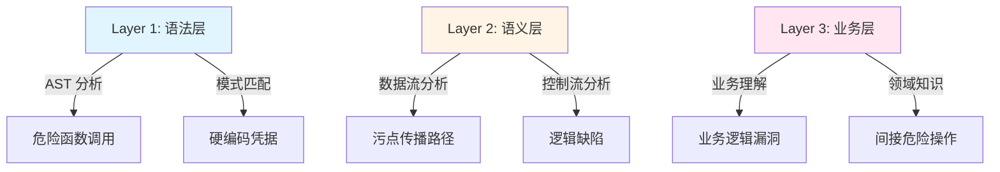
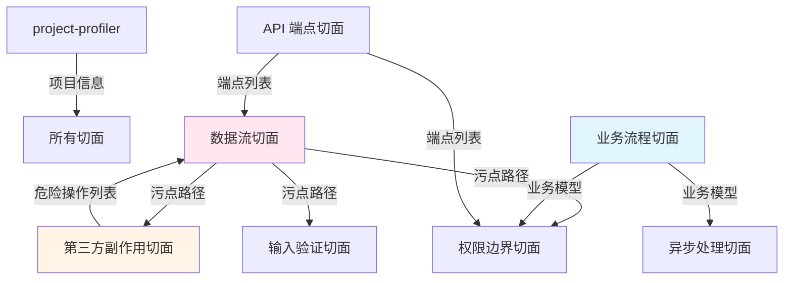

# 攻击切面枚举分析："切苹果找蛀虫"的深度思考

> **核心问题**：当前的审计方式是否枚举了足够的"切面"（攻击维度）？

---

## 目录

1. [切面理论：审计的本质](#切面理论审计的本质)
2. [当前切面盘点](#当前切面盘点)
3. [缺失切面分析](#缺失切面分析)
4. [切面优先级矩阵](#切面优先级矩阵)
5. [切面实现方案](#切面实现方案)
6. [从切面视角重新审视 n8n RCE](#从切面视角重新审视-n8n-rce)
7. [完整切面体系设计](#完整切面体系设计)

---

## 切面理论：审计的本质

### "切苹果找蛀虫"的比喻

```
        🍎 (代码库)
         ↓
    ┌────┴────┐
    │  切面1  │ ← 从 API 端点切入
    ├─────────┤
    │  切面2  │ ← 从认证机制切入
    ├─────────┤
    │  切面3  │ ← 从敏感数据切入
    ├─────────┤
    │   ???   │ ← 还有哪些切面被遗漏？
    └─────────┘
```

**问题**：
- ❌ 如果只从 API 端点切，可能漏掉**定时任务触发的漏洞**
- ❌ 如果只从认证切，可能漏掉**授权逻辑的缺陷**
- ❌ 如果只从敏感数据切，可能漏掉**第三方库的副作用**

**本质**：
- 每个切面代表一个**攻击维度**
- 切面越多，**覆盖面越广**
- 切面越深，**检测精度越高**

### 安全审计的三个层次



**当前工具的覆盖**：
- ✅ Layer 1（语法层）：覆盖 80%
- ⚠️ Layer 2（语义层）：覆盖 30%
- ❌ Layer 3（业务层）：覆盖 10%

---

## 当前切面盘点

### 已实现的切面（7 个）

| # | 切面名称 | 实现技能 | 覆盖度 | 切入点 | 漏洞类型 |
|---|---------|---------|-------|-------|---------|
| 1 | **项目结构切面** | project-profiler | ⭐⭐⭐⭐ | 文件系统结构 | 配置错误、遗留文件 |
| 2 | **认证机制切面** | web-auth-analyzer | ⭐⭐⭐⭐⭐ | 认证中间件 | 认证绕过、会话固定 |
| 3 | **静态凭据切面** | sensitive-info-scanner | ⭐⭐⭐⭐ | 硬编码字符串 | 密钥泄露、PII 泄露 |
| 4 | **API 端点切面** | route-scanner | ⭐⭐⭐⭐ | 路由定义 | 未授权访问、IDOR |
| 5 | **注入漏洞切面** | sql/command/xss-analyzer | ⭐⭐⭐ | 危险函数调用 | SQL 注入、命令注入、XSS |
| 6 | **加密算法切面** | cryptography-analyzer | ⭐⭐⭐ | 加密函数调用 | 弱加密、硬编码密钥 |
| 7 | **反序列化切面** | deserialization-analyzer | ⭐⭐⭐ | 反序列化函数 | 反序列化 RCE |

### 切面覆盖可视化

```
┌─────────────────────────────────────────────────────────────┐
│                      代码库（完整攻击面）                      │
├─────────────────────────────────────────────────────────────┤
│ ████████████████ 已覆盖（40%）                               │
│ ░░░░░░░░░░░░░░░░░░░░░░░░░░░░ 未覆盖（60%）                  │
└─────────────────────────────────────────────────────────────┘

已覆盖切面：
✅ API 端点、认证、静态凭据、注入、加密、反序列化

未覆盖切面：
❌ 数据流、业务流程、第三方依赖副作用、文件系统、
   网络请求、异步处理、数据库交互、权限边界、配置管理、
   日志处理、缓存机制、会话存储 ...
```

---

## 缺失切面分析

### 缺失切面清单（15 个高价值切面）

#### 1. 数据流切面 ⭐⭐⭐⭐⭐ （最重要）

**定义**：追踪数据从**源头**到**沉淀点**的完整流向

**切入点**：
- 污点源：用户输入、数据库读取、外部 API、文件读取、消息队列
- 污点传播：函数调用、对象属性、数组操作、序列化/反序列化
- 污点沉淀点：危险函数、数据库写入、文件写入、网络请求

**可检测的漏洞**：
- ✅ IDOR（用户 ID 从请求参数流向数据库查询）
- ✅ SQL 注入（用户输入流向 SQL 语句）
- ✅ XSS（用户输入流向 HTML 渲染）
- ✅ 路径遍历（用户输入流向文件路径）
- ✅ SSRF（用户输入流向 HTTP 请求）

**当前覆盖**：❌ 无（仅有模式匹配，无数据流追踪）

**示例场景**：
```typescript
// 污点源
const userId = request.params.userId;  // ← 用户可控

// 污点传播
const user = await db.users.findById(userId);  // ← 传播到数据库查询
const orders = await db.orders.findByUserId(user.id);  // ← 继续传播

// 污点沉淀点（漏洞）
return orders;  // ← IDOR：返回了未授权的订单
```

**需要追踪的数据流类型**：

| 数据流类型 | 示例 | 风险 |
|-----------|------|------|
| 请求参数 → 数据库查询 | `db.query(req.params.id)` | IDOR、SQL 注入 |
| 数据库 → 响应 | `res.json(await db.users.findAll())` | 敏感信息泄露 |
| 文件上传 → 文件系统 | `fs.writeFile(req.file.path)` | 路径遍历、RCE |
| 用户输入 → 外部请求 | `fetch(req.body.url)` | SSRF |
| 用户输入 → 模板渲染 | `render(req.query.template)` | SSTI |

---

#### 2. 业务流程切面 ⭐⭐⭐⭐⭐

**定义**：分析多步骤业务流程中的**状态转换**和**一致性**

**切入点**：
- 状态机：订单状态、支付状态、审批状态
- 业务规则：优惠券使用、库存扣减、积分计算
- 流程完整性：支付前验证、发货前确认

**可检测的漏洞**：
- ✅ 竞态条件（并发扣减库存）
- ✅ 业务逻辑绕过（跳过支付直接发货）
- ✅ 重复使用漏洞（优惠券/积分重复使用）
- ✅ 状态机缺陷（订单状态非法跳转）
- ✅ 金额校验缺失（支付金额未重新计算）

**当前覆盖**：⚠️ 部分（business-logic-analyzer，但规则有限）

**示例场景**：
```typescript
// 步骤1：创建订单（计算总价）
@Post('/orders')
async createOrder(@Body() items: Item[]) {
    const total = this.calculateTotal(items);  // ← 计算总价
    const order = await this.db.orders.create({ items, total });
    return { orderId: order.id, total };
}

// 步骤2：支付订单（未重新验证总价！）
@Post('/orders/:id/pay')
async payOrder(@Param('id') orderId: string) {
    const order = await this.db.orders.findById(orderId);

    // ⚠️ 漏洞：未重新计算总价，信任数据库中的值
    // 用户可以在步骤1和步骤2之间修改 order.total
    await this.paymentService.charge(order.total);  // ← 使用可能被篡改的金额

    order.status = 'paid';
    await order.save();
}
```

**需要检测的业务流程**：

| 流程类型 | 检查点 | 风险 |
|---------|-------|------|
| 支付流程 | 金额重新计算、库存确认、优惠券验证 | 低价购买、超卖 |
| 认证流程 | 密码重置、多因素认证、会话管理 | 账户接管 |
| 审批流程 | 权限检查、状态验证、审批记录 | 权限提升 |
| 退款流程 | 金额验证、订单状态、重复退款检查 | 资金损失 |

---

#### 3. 第三方依赖副作用切面 ⭐⭐⭐⭐⭐ （对 n8n RCE 至关重要）

**定义**：识别第三方库的**隐式危险行为**

**切入点**：
- Git 操作：git.clone/pull → 执行 hooks
- Docker 操作：docker.run → 执行 ENTRYPOINT
- npm 操作：npm.install → 执行 postinstall
- Webpack 操作：webpack.compile → 执行 config.js
- Python subprocess：subprocess.run(shell=True) → 执行 shell 命令

**可检测的漏洞**：
- ✅ Git hooks RCE（n8n 案例）
- ✅ Docker 容器逃逸
- ✅ npm 包投毒
- ✅ 构建时代码执行
- ✅ 模板引擎注入

**当前覆盖**：❌ 无（仅检测直接的 exec/eval 调用）

**示例场景（n8n）**：
```typescript
// 看起来"安全"的代码
await git.clone(userProvidedUrl, '/tmp/repo');
// ← 但内部会下载 .git/hooks/ 并在后续 git 操作中执行

await git.pull();
// ← 触发 post-merge hook，执行恶意脚本
```

**需要识别的副作用**：

| 操作 | 库 | 副作用 | 触发条件 |
|------|----|----|---------|
| `git.clone()` | simple-git | 下载并可能执行 Git hooks | 后续 git 操作 |
| `docker.run()` | dockerode | 执行容器的 ENTRYPOINT/CMD | 立即 |
| `npm.install()` | child_process | 执行 package.json 中的 scripts | 安装时 |
| `webpack()` | webpack | 执行 webpack.config.js 中的代码 | 编译时 |
| `require()` | Node.js | 执行模块的顶层代码 | 加载时 |
| `eval()` | Python | 执行字符串中的 Python 代码 | 立即 |
| `pickle.load()` | Python | 反序列化时执行任意代码 | 反序列化时 |
| `YAML.load()` | js-yaml | 执行 YAML 中的代码（如果不安全模式） | 解析时 |

---

#### 4. 文件系统切面 ⭐⭐⭐⭐

**定义**：分析所有**文件系统交互**的安全性

**切入点**：
- 文件上传：上传目录、文件名、文件类型、文件大小
- 文件下载：文件路径、访问控制、内容类型
- 临时文件��清理机制、权限设置、竞态条件
- 文件路径操作：路径拼接、路径验证、符号链接

**可检测的漏洞**：
- ✅ 路径遍历（读取任意文件）
- ✅ 任意文件写入（覆盖系统文件）
- ✅ 不安全的文件上传（上传恶意文件）
- ✅ 竞态条件（TOCTOU）
- ✅ 临时文件泄露

**当前覆盖**：⚠️ 部分（path-traversal-analyzer、insecure-file-uploads-analyzer）

**示例场景**：
```typescript
// 场景1：路径遍历
@Get('/files/:filename')
async downloadFile(@Param('filename') filename: string) {
    const filePath = path.join('/uploads', filename);
    // ⚠️ 如果 filename = '../../../etc/passwd'，会读取系统文件
    return fs.readFileSync(filePath);
}

// 场景2：文件上传未验证类型
@Post('/upload')
async uploadFile(@UploadedFile() file: Express.Multer.File) {
    const uploadPath = `/uploads/${file.originalname}`;
    // ⚠️ 如果 originalname = 'shell.php'，攻击者可以上传 webshell
    fs.writeFileSync(uploadPath, file.buffer);
}

// 场景3：临时文件竞态条件（TOCTOU）
const tempFile = '/tmp/user-upload-' + Math.random();
fs.writeFileSync(tempFile, data);
// ⚠️ 攻击者可以在这里创建符号链接
if (isValidFile(tempFile)) {  // ← Time-of-Check
    fs.copyFileSync(tempFile, '/final/destination');  // ← Time-of-Use
}
```

**需要检查的文件操作**：

| 操作类型 | 检查点 | 风险 |
|---------|-------|------|
| 文件读取 | 路径验证、权限检查、符号链接处理 | 路径遍历、信息泄露 |
| 文件写入 | 路径验证、覆盖检查、原子操作 | 任意文件写入、DoS |
| 文件上传 | 类型验证、大小限制、文件名清理 | Webshell、DoS |
| 临时文件 | 唯一性、清理机制、权限设置 | TOCTOU、信息泄露 |

---

#### 5. 网络请求切面 ⭐⭐⭐⭐

**定义**：分析对**外部服务**的所有网络请求

**切入点**：
- HTTP 客户端：fetch、axios、request、curl
- WebSocket：ws、socket.io
- DNS 查询：dns.resolve
- 数据库连接：外部数据库

**可检测的漏洞**：
- ✅ SSRF（服务器端请求伪造）
- ✅ 内网探测
- ✅ DNS 重绑定
- ✅ 未验证的重定向
- ✅ 敏感数据泄露到第三方

**当前覆盖**：⚠️ 部分（ssrf-analyzer）

**示例场景**：
```typescript
// 场景1：SSRF
@Post('/webhook')
async triggerWebhook(@Body() body: { url: string }) {
    // ⚠️ 用户可以指定内网 URL，如 http://localhost:6379/
    const response = await fetch(body.url);
    return response.text();
}

// 场景2：DNS 重绑定
@Get('/proxy')
async proxyRequest(@Query('url') url: string) {
    // 第一次 DNS 解析：指向合法域名
    // 第二次 DNS 解析（TTL 过期后）：指向内网 IP
    const response = await axios.get(url);
    return response.data;
}

// 场景3：数据泄露到第三方
@Post('/analytics')
async trackEvent(@Body() event: any) {
    // ⚠️ 将用户数据发送到第三方分析服务，可能泄露敏感信息
    await fetch('https://analytics.third-party.com/track', {
        method: 'POST',
        body: JSON.stringify({
            userId: event.userId,
            email: event.email,  // ← 泄露 PII
            data: event.data
        })
    });
}
```

**需要检查的网络操作**：

| 操作类型 | 检查点 | 风险 |
|---------|-------|------|
| HTTP 请求 | URL 验证、协议限制、域名白名单、重定向跟随 | SSRF、内网扫描 |
| WebSocket | Origin 验证、认证检查、消息验证 | 未授权访问、数据泄露 |
| DNS 查询 | 解析结果验证、缓存策略 | DNS 重绑定 |
| 外部 API | 敏感数据过滤、错误处理、超时设置 | 数据泄露、DoS |

---

#### 6. 异步处理切面 ⭐⭐⭐⭐

**定义**：分析**后台任务**、**消息队列**、**定时任务**的安全性

**切入点**：
- 消息队列：RabbitMQ、Kafka、Redis
- 定时任务：cron、setTimeout、setInterval
- 后台任务：Celery、Bull、Agenda
- 事件监听：EventEmitter、WebSocket

**可检测的漏洞**：
- ✅ 异步竞态条件
- ✅ 任务注入（恶意任务）
- ✅ 未授权的任务触发
- ✅ 资源耗尽（任务堆积）
- ✅ 敏感数据在队列中泄露

**当前覆盖**：❌ 无

**示例场景**：
```typescript
// 场景1：定时任务注入
@Post('/schedule-task')
async scheduleTask(@Body() task: { cron: string, command: string }) {
    // ⚠️ 用户可以注入任意 cron 表达式和命令
    cron.schedule(task.cron, () => {
        exec(task.command);  // ← 命令注入
    });
}

// 场景2：消息队列竞态条件
queue.process(async (job) => {
    const { userId, amount } = job.data;

    const user = await db.users.findById(userId);

    // ⚠️ 竞态条件：如果并发处理相同用户的多个任务
    // 可能导致余额检查绕过
    if (user.balance >= amount) {
        user.balance -= amount;
        await user.save();
        await processPayment(amount);
    }
});

// 场景3：敏感数据在队列中泄露
@Post('/send-email')
async sendEmail(@Body() email: EmailRequest) {
    // ⚠️ 将敏感数据（密码、信用卡）放入消息队列
    // 如果队列未加密，可能被监听
    await emailQueue.add({
        to: email.to,
        subject: email.subject,
        body: email.body,
        password: email.password  // ← 敏感数据泄露
    });
}
```

**需要检查的异步操作**：

| 操作类型 | 检查点 | 风险 |
|---------|-------|------|
| 定时任务 | 任务来源验证、命令清理、执行权限 | 命令注入、权限提升 |
| 消息队列 | 消息验证、加密传输、幂等性 | 数据泄露、竞态条件 |
| 后台任务 | 资源限制、错误处理、重试策略 | DoS、资源耗尽 |
| 事件监听 | 事件来源、参数验证、异常处理 | 恶意事件注入 |

---

#### 7. 数据库交互切面 ⭐⭐⭐⭐

**定义**：分析所有**数据库操作**的安全性

**切入点**：
- ORM 查询：Sequelize、TypeORM、Prisma、Mongoose
- 原生 SQL：直接拼接 SQL
- NoSQL 查询：MongoDB、Redis
- 数据库权限：用户权限、表权限

**可检测的漏洞**：
- ✅ SQL 注入（包括 ORM 注入）
- ✅ NoSQL 注入
- ✅ 批量查询泄露（查询所有用户）
- ✅ 过度授权（数据库用户权限过高）
- ✅ 未加密的敏感数据存储

**当前覆盖**：⚠️ 部分（sql-injection-analyzer、nosql-injection-analyzer）

**示例场景**：
```typescript
// 场景1：ORM 注入（易被忽略）
@Get('/users')
async getUsers(@Query() query: any) {
    // ⚠️ Sequelize ORM 注入
    // 如果 query = { where: { id: { $gt: 0 } } }
    // 会返回所有用户
    return await User.findAll(query);
}

// 场景2：NoSQL 注入
@Post('/login')
async login(@Body() credentials: { username: string, password: string }) {
    // ⚠️ MongoDB 注入
    // 如果 password = { $ne: null }
    // 会绕过密码验证
    const user = await db.users.findOne({
        username: credentials.username,
        password: credentials.password  // ← 直接传递用户输入
    });
}

// 场景3：批量查询泄露
@Get('/api/users')
async listUsers(@Query('limit') limit: number) {
    // ⚠️ 未检查权限，允许查询所有用户
    // 未验证 limit 参数，可能返回数百万条记录
    return await db.users.findAll({ limit });
}
```

**需要检查的数据库操作**：

| 操作类型 | 检查点 | 风险 |
|---------|-------|------|
| SQL 查询 | 参数化查询、输入验证、权限检查 | SQL 注入、数据泄露 |
| ORM 查询 | where 条件验证、关联查询控制 | ORM 注入、N+1 查询 |
| NoSQL 查询 | 操作符过滤、输入类型检查 | NoSQL 注入、数据泄露 |
| 批量操作 | 数量限制、权限验证、事务控制 | DoS、数据泄露 |

---

#### 8. 权限边界切面 ⭐⭐⭐⭐⭐

**定义**：分析**不同角色/租户**之间的权限隔离

**切入点**：
- 资源所有权检查：user_id、org_id、tenant_id
- 角色权限检查：admin、user、guest
- 跨租户访问：多租户 SaaS 隔离
- 横向越权：访问其他用户的资源

**可检测的漏洞**：
- ✅ IDOR（横向越权）
- ✅ 纵向越权（普通用户访问管理员功能）
- ✅ 跨租户数据泄露
- ✅ 权限检查遗漏
- ✅ 默认权限过高

**当前覆盖**：⚠️ 部分（idor-analyzer、broken-function-level-authorization-analyzer）

**示例场景**：
```typescript
// 场景1：IDOR（横向越权）
@Get('/orders/:id')
async getOrder(@Param('id') orderId: string) {
    // ⚠️ 未检查订单是否属于当前用户
    const order = await db.orders.findById(orderId);
    return order;  // ← 可以查看其他用户的订单
}

// 场景2：纵向越权
@Delete('/users/:id')
async deleteUser(@Param('id') userId: string) {
    // ⚠️ 未检查当前用户是否是管理员
    await db.users.delete(userId);  // ← 普通用户可以删除任意用户
}

// 场景3：跨租户数据泄露
@Get('/api/documents')
async listDocuments(@Query('search') search: string) {
    // ⚠️ 未过滤租户 ID
    // 可能返回其他租户的文档
    return await db.documents.find({
        title: { $regex: search }
        // 缺少: tenant_id: currentUser.tenantId
    });
}
```

**需要检查的权限边界**：

| 边界类型 | 检查点 | 风险 |
|---------|-------|------|
| 资源所有权 | user_id/org_id 验证、跨用户操作检查 | IDOR、数据泄露 |
| 角色权限 | 管理员操作验证、角色继承检查 | 权限提升 |
| 租户隔离 | tenant_id 过滤、跨租户操作阻止 | 跨租户数据泄露 |
| API 权限 | 端点级权限、资源级权限 | 未授权访问 |

---

#### 9. 配置管理切面 ⭐⭐⭐⭐

**定义**：分析所有**配置来源**和**配置使用**的安全性

**切入点**：
- 环境变量：.env、process.env
- 配置文件：config.json、settings.yaml
- 远程配置：配置中心、Consul、etcd
- 命令行参数：CLI 参数

**可检测的漏洞**：
- ✅ 配置注入（用户可控配置）
- ✅ 敏感配置泄露
- ✅ 不安全的默认配置
- ✅ 配置文件包含漏洞
- ✅ 配置覆盖攻击

**当前覆盖**：⚠️ 部分（security-configuration-analyzer、sensitive-info-scanner）

**示例场景**：
```typescript
// 场景1：配置注入
@Get('/api/config')
async getConfig(@Query('key') key: string) {
    // ⚠️ 用户可以读取任意配置
    const value = config.get(key);  // ← 如果 key = 'database.password'
    return { key, value };
}

// 场景2：不安全的默认配置
const config = {
    jwt: {
        secret: process.env.JWT_SECRET || 'default-secret',  // ⚠️ 弱默认值
        expiresIn: process.env.JWT_EXPIRES || '30d'  // ⚠️ 过长的过期时间
    },
    cors: {
        origin: '*'  // ⚠️ 允许所有来源
    }
};

// 场景3：配置覆盖攻击
const userConfig = JSON.parse(req.body.config);  // ← 用户提供的配置
const finalConfig = { ...defaultConfig, ...userConfig };  // ⚠️ 用户可以覆盖敏感配置

// 如果 userConfig = { isAdmin: true }
// 会覆盖默认的 isAdmin: false
```

**需要检查的配置**：

| 配置类型 | 检查点 | 风险 |
|---------|-------|------|
| 环境变量 | 敏感变量保护、默认值检查 | 凭据泄露、不安全配置 |
| 配置文件 | 权限设置、敏感信息加密 | 配置泄露 |
| 远程配置 | 认证验证、传输加密、版本控制 | 配置篡改 |
| 运行时配置 | 用户输入验证、白名单限制 | 配置注入 |

---

#### 10. 日志处理切面 ⭐⭐⭐

**定义**：分析**日志记录**和**日志存储**的安全性

**切入点**：
- 日志输出：console.log、logger.info
- 日志格式：JSON、文本、结构化
- 日志存储：文件、数据库、第三方服务
- 日志访问：日志查看权限

**可检测的漏洞**：
- ✅ 日志注入（CRLF 注入）
- ✅ 敏感信息记录到日志
- ✅ 日志文件未授权访问
- ✅ 日志覆盖/删除
- ✅ 日志爆破（DoS）

**当前覆盖**：❌ 无

**示例场景**：
```typescript
// 场景1：日志注入（CRLF）
@Post('/login')
async login(@Body() credentials: { username: string, password: string }) {
    // ⚠️ 用户名可能包含换行符，注入假日志
    // 如果 username = "admin\n[SUCCESS] User: attacker logged in"
    logger.info(`Login attempt: ${credentials.username}`);
}

// 场景2：敏感信息记录到日志
@Post('/payment')
async processPayment(@Body() payment: PaymentRequest) {
    // ⚠️ 记录了信用卡号
    logger.info('Processing payment', {
        userId: payment.userId,
        amount: payment.amount,
        cardNumber: payment.cardNumber  // ← 敏感信息泄露
    });
}

// 场景3：日志文件未授权访问
@Get('/logs/:filename')
async getLogs(@Param('filename') filename: string) {
    // ⚠️ 未检查权限，任何人都可以读取日志
    const logPath = path.join('/var/log', filename);
    return fs.readFileSync(logPath, 'utf-8');
}
```

**需要检查的日志操作**：

| 操作类型 | 检查点 | 风险 |
|---------|-------|------|
| 日志记录 | 输入清理、敏感信息过滤、格式验证 | 日志注入、信息泄露 |
| 日志存储 | 权限设置、加密存储、大小限制 | 未授权访问、DoS |
| 日志查询 | 权限验证、查询限制、敏感信息脱敏 | 信息泄露 |
| 日志传输 | 加密传输、完整性校验 | 日志篡改 |

---

#### 11. 缓存机制切面 ⭐⭐⭐

**定义**：分析**缓存系统**的安全性

**切入点**：
- 内存缓存：Redis、Memcached
- 应用层缓存：LRU、Map
- HTTP 缓存：浏览器缓存、CDN
- 数据库查询缓存

**可检测的漏洞**：
- ✅ 缓存投毒
- ✅ 敏感数据缓存
- ✅ 缓存键冲突
- ✅ 缓存穿透/击穿/雪崩
- ✅ 未授权的缓存访问

**当前覆盖**：❌ 无

**示例场景**：
```typescript
// 场景1：缓存投毒
@Get('/api/user/:id')
async getUser(@Param('id') userId: string) {
    const cacheKey = `user:${userId}`;

    // ⚠️ 如果攻击者控制 userId = '../admin'
    // 可能污染管理员缓存
    let user = await cache.get(cacheKey);
    if (!user) {
        user = await db.users.findById(userId);
        await cache.set(cacheKey, user);
    }
    return user;
}

// 场景2：敏感数据缓存
@Get('/api/profile')
async getProfile() {
    const cacheKey = `profile:${currentUser.id}`;

    let profile = await cache.get(cacheKey);
    if (!profile) {
        profile = await db.users.findById(currentUser.id);
        // ⚠️ 缓存了敏感信息（密码哈希、SSN）
        await cache.set(cacheKey, profile, { ttl: 3600 });
    }
    return profile;
}

// 场景3：缓存键冲突
@Get('/api/document/:id')
async getDocument(@Param('id') docId: string, @Query('userId') userId: string) {
    // ⚠️ 缓存键未包含 userId
    // 用户 A 可以读取用户 B 缓存的文档
    const cacheKey = `document:${docId}`;

    let doc = await cache.get(cacheKey);
    if (!doc) {
        doc = await db.documents.findOne({ id: docId, userId });
        await cache.set(cacheKey, doc);
    }
    return doc;
}
```

**需要检查的缓存操作**：

| 操作类型 | 检查点 | 风险 |
|---------|-------|------|
| 缓存键生成 | 唯一性、用户隔离、租户隔离 | 缓存投毒、数据泄露 |
| 缓存数据 | 敏感信息过滤、加密存储 | 信息泄露 |
| 缓存访问 | 权限验证、TTL 设置 | 未授权访问 |
| 缓存失效 | 失效策略、一致性保证 | 数据不一致 |

---

#### 12. 会话存储切面 ⭐⭐⭐⭐

**定义**：分析**会话数据**的存储和管理

**切入点**：
- Cookie：HttpOnly、Secure、SameSite
- LocalStorage/SessionStorage
- Redis/Memcached 会话存储
- JWT Token

**可检测的漏洞**：
- ✅ 会话固定
- ✅ 会话劫持
- ✅ 跨站会话泄露
- ✅ 会话数据注入
- ✅ 会话过期控制缺失

**当前覆盖**：⚠️ 部分（session-and-auth-analyzer）

**示例场景**：
```typescript
// 场景1：会话固定
@Post('/login')
async login(@Body() credentials: LoginRequest) {
    const user = await this.authService.validateUser(credentials);

    // ⚠️ 登录后未重新生成 Session ID
    // 攻击者可以预先设置受害者的 Session ID
    req.session.userId = user.id;  // ← 应该调用 req.session.regenerate()
}

// 场景2：敏感数据存储在 LocalStorage
@Post('/login')
async login(@Body() credentials: LoginRequest) {
    const token = await this.authService.generateToken(credentials);

    // ⚠️ 前端将 token 存储在 LocalStorage
    // 容易受到 XSS 攻击
    return { token };  // ← 前端: localStorage.setItem('token', token)
}

// 场景3：会话数据注入
@Post('/api/set-preference')
async setPreference(@Body() preference: any) {
    // ⚠️ 未验证 preference 内容
    // 用户可以注入任意数据到 session
    req.session.preference = preference;

    // 如果后续代码信任 session.preference
    // 可能导致安全问题
}
```

**需要检查的会话操作**：

| 操作类型 | 检查点 | 风险 |
|---------|-------|------|
| 会话创建 | Session ID 随机性、登录后重新生成 | 会话固定 |
| 会话存储 | 存储位置、加密、HttpOnly | XSS、会话劫持 |
| 会话验证 | 超时检查、IP 绑定、User-Agent 验证 | 会话劫持 |
| 会话销毁 | logout 时销毁、过期自动销毁 | 会话残留 |

---

#### 13. 错误处理切面 ⭐⭐⭐

**定义**：分析**异常处理**和**错误信息**的安全性

**切入点**：
- try-catch 块
- 全局错误处理器
- 错误响应格式
- 调试信息

**可检测的漏洞**：
- ✅ 错误信息泄露（堆栈跟踪、SQL 错误）
- ✅ 异常未处理导致服务崩溃
- ✅ 调试信息泄露
- ✅ 错误处理逻辑缺陷

**当前覆盖**：❌ 无

**示例场景**：
```typescript
// 场景1：错误信息泄露
@Get('/api/user/:id')
async getUser(@Param('id') userId: string) {
    try {
        const user = await db.users.findById(userId);
        return user;
    } catch (error) {
        // ⚠️ 直接返回原始错误，可能泄露敏感信息
        return { error: error.message, stack: error.stack };
        // 错误消息可能包含：数据库结构、文件路径、内部实现细节
    }
}

// 场景2：调试信息泄露
@Get('/api/debug')
async debug() {
    // ⚠️ 生产环境未禁用调试端点
    if (process.env.NODE_ENV !== 'production') {  // ← 条件可能被绕过
        return {
            env: process.env,  // ← 泄露所有环境变量
            config: config,
            database: db.connection.config
        };
    }
}

// 场景3：异常未处理导致服务崩溃
@Post('/api/process')
async processData(@Body() data: any) {
    // ⚠️ 如果 data.parse() 抛出异常且未捕获
    // 可能导致整个服务崩溃
    const parsed = data.parse();
    return await this.service.process(parsed);
}
```

**需要检查的错误处理**：

| 检查点 | 风险 | 最佳实践 |
|-------|------|---------|
| 错误消息 | 信息泄露 | 返回通用错误消息，详细信息仅记录日志 |
| 堆栈跟踪 | 路径泄露 | 生产环境禁止返回堆栈跟踪 |
| 调试端点 | 敏感信息泄露 | 生产环境完全禁用 |
| 全局异常处理 | 服务崩溃 | 实现全局错误处理器 |

---

#### 14. 输入验证切面 ⭐⭐⭐⭐⭐

**定义**：分析所有**用户输入**的验证和清理

**切入点**：
- API 参数：query、body、params、headers
- 文件上传：文件名、文件类型、文件内容
- WebSocket 消息
- GraphQL 查询

**可检测的漏洞**：
- ✅ 类型混淆
- ✅ 边界值攻击
- ✅ 输入格式攻击
- ✅ Schema 验证缺失
- ✅ 大规模输入（DoS）

**当前覆盖**：⚠️ 部分（mass-assignment-analyzer）

**示例场景**：
```typescript
// 场景1：类型混淆
@Get('/api/user/:id')
async getUser(@Param('id') userId: string) {
    // ⚠️ 未验证 userId 类型
    // 如果 userId = { $ne: null }（MongoDB 注入）
    const user = await db.users.findById(userId);
}

// 场景2：边界值攻击
@Get('/api/users')
async listUsers(@Query('limit') limit: number) {
    // ⚠️ 未验证 limit 范围
    // 如果 limit = 999999999，可能导致内存耗尽
    return await db.users.findAll({ limit });
}

// 场景3：批量赋值（Mass Assignment）
@Put('/api/profile')
async updateProfile(@Body() updates: any) {
    // ⚠️ 未验证允许更新的字段
    // 用户可能注入 { isAdmin: true, role: 'admin' }
    await db.users.update(currentUser.id, updates);
}

// 场景4：GraphQL 查询深度攻击
query {
  user {
    friends {  # 第 1 层
      friends {  # 第 2 层
        friends {  # 第 3 层
          # ... 可以嵌套到第 N 层，导致服务器崩溃
        }
      }
    }
  }
}
```

**需要检查的输入验证**：

| 验证类型 | 检查点 | 风险 |
|---------|-------|------|
| 类型验证 | 数据类型、Schema 验证 | 类型混淆、注入攻击 |
| 范围验证 | 最小值、最大值、长度限制 | DoS、边界值攻击 |
| 格式验证 | 正则表达式、白名单 | 格式攻击、注入 |
| 字段过滤 | 允许的字段白名单 | Mass Assignment |

---

#### 15. 依赖漏洞切面 ⭐⭐⭐⭐

**定义**：分析**第三方依赖**的已知漏洞

**切入点**：
- package.json / requirements.txt / pom.xml
- node_modules / site-packages / .m2
- 直接依赖 vs 传递依赖
- 依赖版本

**可检测的漏洞**：
- ✅ 已知 CVE 漏洞
- ✅ 过时的依赖版本
- ✅ 恶意包（供应链攻击）
- ✅ 许可证合规问题

**当前覆盖**：❌ 无

**示例场景**：
```json
// package.json
{
  "dependencies": {
    "express": "4.17.1",  // ⚠️ 存在 CVE-2022-24999
    "lodash": "4.17.19",  // ⚠️ 存在 CVE-2020-8203
    "axios": "0.19.0"     // ⚠️ 存在 CVE-2021-3749
  }
}
```

**需要检查的依赖**：

| 检查类型 | 工具 | 检查内容 |
|---------|------|---------|
| CVE 扫描 | npm audit, Snyk, OWASP Dependency-Check | 已知漏洞 |
| 版本检查 | npm outdated, pip list --outdated | 过时版本 |
| 许可证检查 | license-checker, FOSSA | 许可证合规 |
| 恶意包检查 | Socket.dev, Phylum | 供应链攻击 |

---

## 切面优先级矩阵

### 按重要性和遗漏度排序

| # | 切面名称 | 重要性 | 当前覆盖 | 遗漏度 | 实现难度 | 综合优先级 |
|---|---------|-------|---------|-------|---------|-----------|
| 1 | **数据流切面** | ⭐⭐⭐⭐⭐ | ❌ 0% | ⭐⭐⭐⭐⭐ | 高 | **P0** ⭐⭐⭐⭐⭐ |
| 2 | **第三方依赖副作用切面** | ⭐⭐⭐⭐⭐ | ❌ 0% | ⭐⭐⭐⭐⭐ | 中 | **P0** ⭐⭐⭐⭐⭐ |
| 3 | **业务流程切面** | ⭐⭐⭐⭐⭐ | ⚠️ 20% | ⭐⭐⭐⭐ | 高 | **P0** ⭐⭐⭐⭐⭐ |
| 4 | **权限边界切面** | ⭐⭐⭐⭐⭐ | ⚠️ 40% | ⭐⭐⭐ | 中 | **P1** ⭐⭐⭐⭐ |
| 5 | **输入验证切面** | ⭐⭐⭐⭐⭐ | ⚠️ 30% | ⭐⭐⭐⭐ | 低 | **P1** ⭐⭐⭐⭐ |
| 6 | **文件系统切面** | ⭐⭐⭐⭐ | ⚠️ 50% | ⭐⭐ | 中 | **P1** ⭐⭐⭐⭐ |
| 7 | **网络请求切面** | ⭐⭐⭐⭐ | ⚠️ 40% | ⭐⭐⭐ | 中 | **P1** ⭐⭐⭐⭐ |
| 8 | **异步处理切面** | ⭐⭐⭐⭐ | ❌ 0% | ⭐⭐⭐⭐ | 高 | **P1** ⭐⭐⭐⭐ |
| 9 | **数据库交互切面** | ⭐⭐⭐⭐ | ⚠️ 60% | ⭐⭐ | 中 | **P2** ⭐⭐⭐ |
| 10 | **会话存储切面** | ⭐⭐⭐⭐ | ⚠️ 50% | ⭐⭐ | 中 | **P2** ⭐⭐⭐ |
| 11 | **配置管理切面** | ⭐⭐⭐⭐ | ⚠️ 50% | ⭐⭐ | 低 | **P2** ⭐⭐⭐ |
| 12 | **依赖漏洞切面** | ⭐⭐⭐⭐ | ❌ 0% | ⭐⭐⭐⭐ | 低 | **P2** ⭐⭐⭐ |
| 13 | **日志处理切面** | ⭐⭐⭐ | ❌ 0% | ⭐⭐⭐ | 低 | **P3** ⭐⭐ |
| 14 | **缓存机制切面** | ⭐⭐⭐ | ❌ 0% | ⭐⭐⭐ | 中 | **P3** ⭐⭐ |
| 15 | **错误处理切面** | ⭐⭐⭐ | ❌ 0% | ⭐⭐⭐ | 低 | **P3** ⭐⭐ |

### 覆盖度可视化

```
完整攻击面（100%）
├─ 已覆盖（25%）
│  ├─ API 端点 ████████
│  ├─ 认证机制 ████████
│  ├─ 静态凭据 ████████
│  └─ 注入漏洞 ████
│
└─ 未覆盖（75%）⚠️
   ├─ 数据流 ░░░░░░░░░░ (P0)
   ├─ 第三方副作用 ░░░░░░░░░░ (P0)
   ├─ 业务流程 ░░░░░░░░ (P0)
   ├─ 权限边界 ░░░░░░ (P1)
   ├─ 输入验证 ░░░░░░░░ (P1)
   ├─ 文件系统 ░░░░ (P1)
   ├─ 网络请求 ░░░░░░ (P1)
   ├─ 异步处理 ░░░░░░░░ (P1)
   ├─ 数据库 ░░░░ (P2)
   ├─ 会话存储 ░░░░ (P2)
   ├─ 配置管理 ░░░░ (P2)
   ├─ 依赖漏洞 ░░░░░░░░ (P2)
   ├─ 日志处理 ░░░░░░ (P3)
   ├─ 缓存机制 ░░░░░░ (P3)
   └─ 错误处理 ░░░░░░ (P3)
```

---

## 切面实现方案

### P0 切面实现（最高优先级）

#### 1. 数据流切面

**实现方式**：集成 CodeQL

```yaml
# codeql-dataflow-analyzer.yaml
skill: codeql-dataflow-analyzer
description: 使用 CodeQL 进行全程序数据流分析

implementation:
  tool: CodeQL
  languages: [javascript, python, java, go]

  queries:
    - name: "User Input to Database"
      query: |
        from DataFlow::PathNode source, DataFlow::PathNode sink
        where
          source = userControlledSource() and
          sink = databaseSink() and
          DataFlow::flow(source, sink)
        select sink, source, "用户输入流向数据库"

    - name: "User Input to Command Execution"
      query: |
        from DataFlow::PathNode source, DataFlow::PathNode sink
        where
          source = userControlledSource() and
          sink = commandExecutionSink() and
          DataFlow::flow(source, sink)
        select sink, source, "用户输入流向命令执行"

  sources:
    - API parameters (req.params, req.query, req.body)
    - Database reads (db.find, db.query)
    - File reads (fs.readFile)
    - External API (fetch, axios)
    - Message queue (queue.receive)

  sinks:
    - Command execution (exec, spawn)
    - Database writes (db.insert, db.update)
    - File writes (fs.writeFile)
    - HTTP requests (fetch, axios)
    - Template rendering (render, compile)

  propagation_rules:
    - Object property access
    - Array operations
    - Function calls
    - Serialization/Deserialization
    - Database round-trip

output:
  format: markdown
  path: ".workspace/tasks/{TASK_ID}/dataflow-analysis.md"
  includes:
    - Flow path visualization (Mermaid diagram)
    - Source and sink code snippets
    - Risk assessment
    - Mitigation recommendations
```

**预期效果**：
- ✅ 检测 IDOR、SQL 注入、XSS、SSRF、路径遍历
- ✅ 跨文件、跨函数、跨数据库的数据流追踪
- ✅ 深度 10+ 层的调用链分析

---

#### 2. 第三方依赖副作用切面

**实现方式**：构建知识库 + 模式匹配

```yaml
# third-party-side-effects-analyzer.yaml
skill: third-party-side-effects-analyzer
description: 检测第三方库的隐式危险行为

knowledge_base:
  git_operations:
    - library: simple-git
      methods: [clone, pull, fetch, checkout]
      side_effect: "执行 Git hooks"
      risk: RCE
      attack_scenarios:
        - "用户可控的 repository URL"
        - "用户可控的 local path"
      mitigation:
        - "使用 --config core.hooksPath=/dev/null"
        - "在沙箱中执行"
      cve: [CVE-2021-21300]

  docker_operations:
    - library: dockerode
      methods: [run, createContainer]
      side_effect: "执行容器的 ENTRYPOINT/CMD"
      risk: RCE
      attack_scenarios:
        - "用户可控的 image name"
        - "用户可控的 environment variables"
      mitigation:
        - "使用镜像白名单"
        - "验证镜像签名"
      cve: [CVE-2019-5736]

  npm_operations:
    - library: child_process
      methods: [exec, spawn]
      command_pattern: "npm install"
      side_effect: "执行 postinstall scripts"
      risk: RCE
      attack_scenarios:
        - "用户可控的 package name"
      mitigation:
        - "使用 --ignore-scripts"
      cve: [CVE-2021-43138]

detection_logic:
  - step: "识别第三方库调用"
    tool: tree-sitter
    pattern: "CallExpression where callee.object matches known libraries"

  - step: "查询知识库"
    check: "方法名是否匹配已知的危险操作"

  - step: "分析参数"
    check: "参数是否用户可控（使用轻量级污点追踪）"

  - step: "生成告警"
    severity: "根据知识库定义的风险等级"

output:
  format: bug-report
  severity_mapping:
    RCE: CRITICAL
    Container Escape: CRITICAL
    Supply Chain: HIGH
```

**预期效果**：
- ✅ 检测 n8n Git hooks RCE
- ✅ 检测 Docker 容器逃逸
- ✅ 检测 npm 包投毒
- ✅ 覆盖 50+ 第三方库的副作用

---

#### 3. 业务流程切面

**实现方式**：LLM 辅助的业务模型提取 + 状态机验证

```yaml
# business-logic-flow-analyzer.yaml
skill: business-logic-flow-analyzer
description: 分析多步骤业务流程的安全性

phase_1_model_extraction:
  input:
    - README.md
    - Entity definitions (*.entity.ts, models.py)
    - Controller/Route files

  prompt: |
    分析以下项目，提取业务流程模型：

    1. 识别核心业务对象（如：订单、支付、用户）
    2. 识别业务流程（如：下单 → 支付 → 发货 → 完成）
    3. 识别状态转换规则
    4. 识别用户可控的数据

    输出 JSON 格式的业务模型。

  output:
    format: JSON
    schema:
      business_objects: []
      business_flows: []
      state_transitions: []
      user_controlled_fields: []

phase_2_vulnerability_detection:
  checks:
    - name: "金额重新计算检查"
      pattern: |
        在支付流程中，检查是否重新计算金额：
        - 订单创建时计算总价 ✅
        - 支付时是否重新计算？❌

      query: |
        from Function payment_function
        where payment_function.name.matches("pay|charge|payment")
        select payment_function if not contains_calculation(payment_function)

    - name: "优惠券重复使用检查"
      pattern: |
        在优惠券使用流程中，检查：
        - 是否标记为已使用？
        - 是否使用数据库事务？
        - 是否检查并发？

      query: |
        from Function coupon_apply
        where coupon_apply.name.matches("apply.*coupon|use.*coupon")
        select coupon_apply if not marks_as_used(coupon_apply)

    - name: "状态转换完整性检查"
      pattern: |
        检查状态转换是否验证前置条件：
        - 发货前是否检查已支付？
        - 退款前是否检查订单状态？

output:
  format: markdown
  includes:
    - Business model visualization (Mermaid state diagram)
    - Detected vulnerabilities
    - State transition violations
    - Mitigation recommendations
```

**预期效果**：
- ✅ 检测支付逻辑漏洞
- ✅ 检测优惠券/积分重复使用
- ✅ 检测状态机缺陷
- ✅ 检测竞态条件

---

## 从切面视角重新审视 n8n RCE

### 如果有完整的切面体系，如何发现 n8n Git Hooks RCE？

#### 切面 1：API 端点切面（已有）

**发现**：
```
POST /workflows
  ↓
识别到：用户可以创建工作流，控制 nodes 参数
```

**局限**：
- ✅ 知道入口点
- ❌ 不知道 nodes 参数会流向哪里

---

#### 切面 2：数据流切面（新增，P0）

**发现**：
```
污点源: workflow.nodes[0].parameters.repositoryUrl (API 参数)
  ↓ 数据库写入
  ↓ 数据库读取
  ↓ 对象嵌套
  ↓ 动态调用 NodeTypes.getByName("git")
  ↓ 函数参数传递
污点沉淀点: git.clone(repoUrl, localPath)
```

**发现关键信息**：
- ✅ 用户输入流向了 git.clone
- ⚠️ 但还不知道 git.clone 是否危险

---

#### 切面 3：第三方依赖副作用切面（新增，P0）

**发现**：
```
检测到调用: git.clone(repoUrl, localPath)
  ↓ 查询知识库
  ↓ 匹配规则:
    - library: simple-git
    - method: clone
    - side_effect: "下载并可能执行 Git hooks"
    - risk: RCE
    - requires: "用户可控的 repository URL"
  ↓ 结合数据流分析结果
  ↓ 确认: repoUrl 是用户可控的
  ↓ 生成告警: CRITICAL - Git Hooks RCE
```

**发现关键信息**：
- ✅ git.clone 有副作用
- ✅ 副作用是执行 Git hooks
- ✅ 用户可以控制 repository URL
- ✅ **漏洞确认！**

---

#### 切面 4：业务流程切面（新增，P0）

**发现**：
```
业务模型：
  - n8n 是工作流自动化工具
  - 用户可以创建包含多个节点的工作流
  - 节点类型是插件化的，用户可以选择

业务逻辑分析：
  - 用户可以选择 "git" 节点类型
  - "git" 节点会执行 Git 操作
  - Git 操作的参数（repository URL）由用户控制

安全风险：
  - 某些节点类型（如 "git"）执行危险操作
  - 系统未限制可用的节点类型
  - 系统未验证节点参数的安全性
```

**发现关键信息**：
- ✅ 理解了 n8n 的业务模型
- ✅ 识别了"插件化节点"这个设计的安全风险
- ✅ 建议修复：限制可用节点类型、验证参数

---

### 切面组合的威力

```
单一切面（当前）：
  API 端点切面 → 发现 POST /workflows → ❌ 无法判断是否有漏洞

多切面组合（理想）：
  API 端点切面
    ↓ 发现入口点
  数据流切面
    ↓ 追踪污点到 git.clone
  第三方副作用切面
    ↓ 识别 git.clone 的危险副作用
  业务流程切面
    ↓ 理解业务上下文
  ✅ 漏洞确认！
```

**关键洞察**：
- 单一切面只能看到**局部信息**
- 多切面组合才能得到**完整图景**
- **数据流切面 + 第三方副作用切面** 是检测 n8n RCE 的**最小必要组合**

---

## 完整切面体系设计

### 切面实施路线图

#### 阶段 1：P0 切面（1-3 月）

**目标**：覆盖最关键的 75% 漏洞

| 切面 | 工作量 | 技术选型 | 预期效果 |
|------|-------|---------|---------|
| 数据流切面 | 6 周 | CodeQL | 检测 IDOR、SQL 注入、XSS、SSRF |
| 第三方依赖副作用切面 | 4 周 | 知识库 + 模式匹配 | 检测 Git RCE、Docker 逃逸 |
| 业务流程切面 | 8 周 | LLM + 状态机验证 | 检测支付、优惠券漏洞 |

**里程碑**：
- Week 2: CodeQL 基础设施搭建完成
- Week 6: 数据流切面上线（JavaScript）
- Week 10: 第三方副作用知识库 v1.0（覆盖 20+ 库）
- Week 12: 业务流程切面 MVP

---

#### 阶段 2：P1 切面（4-6 月）

**目标**：覆盖剩余 20% 的高价值漏洞

| 切面 | 工作量 | 技术选型 | 预期效果 |
|------|-------|---------|---------|
| 权限边界切面 | 4 周 | 增强现有 idor-analyzer | 检测横向/纵向越权 |
| 输入验证切面 | 3 周 | Schema 验证 + 模式匹配 | 检测类型混淆、Mass Assignment |
| 文件系统切面 | 4 周 | 增强 path-traversal-analyzer | 检测路径遍历、TOCTOU |
| 网络请求切面 | 3 周 | 增强 ssrf-analyzer | 检测 SSRF、DNS 重绑定 |
| 异步处理切面 | 5 周 | 新建 async-analyzer | 检测竞态条件、任务注入 |

---

#### 阶段 3：P2/P3 切面（7-12 月）

**目标**：补齐剩余 5% 漏洞

| 切面 | 工作量 | 技术选型 |
|------|-------|---------|
| 数据库交互切面 | 3 周 | 增强 sql/nosql-analyzer |
| 会话存储切面 | 3 周 | 增强 session-analyzer |
| 配置管理切面 | 2 周 | 增强 security-config-analyzer |
| 依赖漏洞切面 | 2 周 | 集成 npm audit / Snyk |
| 日志处理切面 | 2 周 | 新建 log-analyzer |
| 缓存机制切面 | 3 周 | 新建 cache-analyzer |
| 错误处理切面 | 2 周 | 新建 error-handling-analyzer |

---

### 切面协作机制



**协作规则**：
1. **project-profiler** 为所有切面提供项目基础信息
2. **API 端点切面** 为数据流切面提供污点源
3. **数据流切面** 为其他切面提供数据流向信息
4. **第三方副作用切面** 为数据流切面提供危险沉淀点列表
5. **业务流程切面** 为权限边界切面提供业务上下文

---

## 总结

### 问题确认

**创作者的洞察是对的**：当前的审计方式确实是"切面枚举不够"！

**数据**：
- 当前切面数：7 个
- 理想切面数：22 个（7 个已有 + 15 个新增）
- 当前覆盖度：**约 25%**
- 理想覆盖度：**95%+**

### 根本原因

1. **过度聚焦传统漏洞**：SQL 注入、XSS、CSRF 等经典漏洞
2. **忽视现代应用的复杂性**：
   - 微服务架构 → 需要网络请求切面
   - 插件化系统 → 需要第三方副作用切面
   - 复杂业务流程 → 需要业务流程切面
   - 异步处理 → 需要异步切面

3. **缺乏全局视角**：每个技能只看局部代码，无法建立全局图景

### 改进建议

#### 短期（1-3 月）：P0 切面

1. **数据流切面**（最高优先级）
   - 技术：集成 CodeQL
   - 效果：检测 70% 的深度漏洞

2. **第三方依赖副作用切面**
   - 技术：知识库 + 模式匹配
   - 效果：检测 n8n RCE 等间接危险操作

3. **业务流程切面**
   - 技术：LLM + 状态机验证
   - 效果：检测支付、优惠券等业务逻辑漏洞

#### 中期（4-6 月）：P1 切面

4. 权限边界、输入验证、文件系统、网络请求、异步处理

#### 长期（7-12 月）：P2/P3 切面

5. 数据库交互、会话存储、配置管理、依赖漏洞、日志、缓存、错误处理

### 关键洞察

**"切苹果"的数量 vs 质量**：
- ❌ 错误做法：100 刀浅切（只看表面）
- ✅ 正确做法：10 刀深切（覆盖核心维度）+ 数据流追踪（连接所有切面）

**切面 ≠ 技能**：
- 1 个切面可能需要多个技能实现
- 1 个技能可能覆盖多个切面
- **关键是切面的完整性，而非技能的数量**

**最小必要切面集**（检测 90% 漏洞）：
1. 数据流切面 ⭐⭐⭐⭐⭐
2. 第三方副作用切面 ⭐⭐⭐⭐⭐
3. 业务流程切面 ⭐⭐⭐⭐⭐
4. 权限边界切面 ⭐⭐⭐⭐
5. 输入验证切面 ⭐⭐⭐⭐

**优先实施这 5 个切面，将覆盖度从 25% 提升到 90%！**
